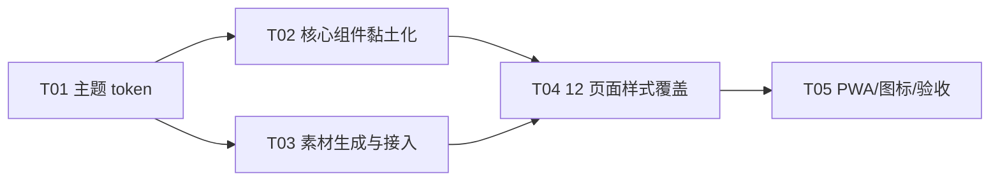

# 全界面 3D 黏土盲盒手办风 · 增量系统设计与 AI 素材精确 prompt 清单（3D v2）

> 文档版本：v2.0 ｜ 角色：架构师 高见远（Gao）· Architect ｜ 语言：简体中文
> 输入：`docs/PRD-3d-v2.md`（产品 许清楚）｜ 基线：`docs/DESIGN-pet-v2.md`、现有 `src/**`、`public/assets/pet/manifest.json`
> 面向：工程师 / AI 出图执行人。**本文只描述纯视觉重构：零功能变更、零数据变更。**

---

## 0. 关键纠正（覆盖 PRD 第 10 节待确认问题 1）

> ⚠️ PRD 第 10 节写「宠物数据仍是青蛙（frog）」「默认保持青蛙造型」是**过时的错误假设**，予以否决。

- **事实**：宠物是**奶油橘猫（cat）**，默认名「布丁」。现有 44 项素材文件名全部为 `cat_*.png`（见 `manifest.json` 与 `public/assets/pet/character/`），基准图为 `_cat_base.png`。
- **本轮口径**：所有角色素材 = **同一只奶油橘猫的 3D 黏土手办版**；**绝不允许出现青蛙、两栖类或任何第二物种**。
- **数据与玩法**：物种、数值、旅行/商店/换装/图鉴等玩法数据保持 `cat` 不变，全部 service / store / types / SQL **一行不改**；本轮只把图片内容换成 3D 黏土、把 UI 控件换成黏土质感。
- 上版 `DESIGN-pet-v2.md` 中的 `$FROG$` / `frog_*` 命名仅为历史文档，不作为本轮出图依据；本轮唯一风格源是本文 §4。

---

## 1. 增量架构说明

### 1.1 沿用现有分层，零新增架构范式

本轮不引入任何新框架、新状态层、新服务。现有链路原样保留：

```
页面/组件（读 store、调 action）  ← 仅在 JSX 上叠加 className / sx 样式
   ↓
useAppStore.ts（store 不变）
   ↓
services.pet（contracts / mock / real 不变）
   ↓
Supabase（表 / RPC / RLS / Realtime / Storage 不变）
```

### 1.2 本轮改动只发生在 3 层

| 层 | 改动对象 | 性质 |
| --- | --- | --- |
| (a) AI 素材文件 | `public/assets/pet/**` 下 44 张图（**同名覆盖**）+ `manifest.json`（`style` 文案更新，key/path/anchor 不变） | 纯图片内容替换 |
| (b) 主题 / CSS token | `src/theme.ts`、`tailwind.config.ts`、`src/index.css`、可选新增 `src/theme-clay.ts` | 纯前端设计 token |
| (c) 组件样式覆盖 | `Layout.tsx`、`Common.tsx`、12 个页面、9 个 `pages/pet/` 子组件 | 仅样式，逻辑零改 |

### 1.3 红线：零 DB 迁移、零 service/store 逻辑改动

- **SQL**：`supabase/migrations/**` 全部不动，**不新增迁移**、不写种子、不改字段（含 `species` 默认值维持现状 `cat`）。
- **service / store / types**：`src/services/**`、`src/store/**`、`src/types.ts` 全部不动；`Result<T>`、演示/真实双实现、`isDemoMode`、Realtime 订阅一律不变。
- **取图机制**：沿用 `PetAsset` / `PetImage` 的「key → manifest.path → `import.meta.env.BASE_URL` 拼接」唯一出口；`OUTFIT_LAYOUT` 锚点不变（新图须按同一锚点裁边）。
- **路由 / PWA 机制**：HashRouter、SW 注册、打包方式不变；PWA 仅换主题色与图标文件。

---

## 2. 文件变更清单

### 2.1 修改（主题 / 全局基座）

| 文件 | 一句话职责（本次改什么） |
| --- | --- |
| `src/theme.ts` | 色板换黏土马卡龙色；`shape.borderRadius` 16→20；`shadows` 改三层黏土投影；`components.*` 覆盖 MUI 卡片/按钮/输入/Chip/导航/Switch/进度条为黏土态。**不改任何业务逻辑。** |
| `tailwind.config.ts` | `brand.*` 同步新色值；新增 `clay.*`（色板/圆角/阴影/高光）工具类与 `boxShadow.clay*`；keyframes 增补黏土动效。 |
| `src/index.css` | body 背景换柔粉雾 + 暖杏/紫柔光晕；新增 `clay-press/release/jelly/hover` 关键帧与 `.clay-*` 工具类；保留 v2.0 动效仅换色；`prefers-reduced-motion` 处理。 |
| `public/assets/pet/manifest.json` | 44 个 key/path/anchor/size 全部保持不变，仅把顶层 `style` 文案改为「3D 黏土盲盒手办风」。**工程按 key 取图逻辑零改。** |
| `public/manifest.webmanifest` | `theme_color` / `background_color` 调为黏土粉 `#F4A6C1` / `#FFF8F1`；图标文件引用不变。 |
| `public/icon-192.png` / `public/icon-512.png` / `public/icon.svg` | PWA/APK 图标黏土化（主角奶油橘猫手办头像）；属锦上添花，可最后做。 |

### 2.2 新增（可选）

| 文件 | 一句话职责 |
| --- | --- |
| `src/theme-clay.ts` | **可选新增**：集中导出黏土 token（色板/圆角/阴影/动效时长/图标底座尺寸），供 MUI、Tailwind、CSS 三处共用，避免魔法值漂移。纯常量文件，不入库、不参与业务逻辑。 |

### 2.3 修改（组件样式覆盖 — 仅样式）

| 文件 | 一句话职责 |
| --- | --- |
| `src/components/Common.tsx` | `GradientCard/SectionCard/EmptyState/SmartImage/ImageViewer/CountdownChip/CandyRain/PetIllustration/SoftDivider/SoftButton` 套用 `.clay-*` 与图标底座；SVG 版 `PetIllustration` 仅作兜底回退保留。 |
| `src/components/Layout.tsx` | 顶栏改暖粉哑光渐变 + 柔影；底部导航改黏土托盘；每项 lucide 图标外套黏土底座（普通/选中态）。 |
| `src/components/DemoBanner.tsx` / `ProtectedRoute.tsx` | 演示条改暖杏黏土提示条；加载态换黏土配色（如与 Common 共用则不必单独改）。 |
| 12 个页面：`Home / Chat / Album / Pet / Mine / Login / Pairing / Anniversary / Wishlist / Whispers / Location / Settings` | 仅替换卡片/按钮/输入/Chip/弹层/空态的样式类与 token；文案、数据展示、事件处理一律不动。各页要点见 PRD §4.2/§4.3。 |
| 9 个 `src/pages/pet/` 子组件：`PetScene / PetYard / PetTravel / PetRoom / PetFurniture / PetWardrobe / PetAlbum / PetShop / PetAsset` | 场景/数值槽/商店/图鉴等套黏土样式；**`PetAsset.tsx` 的取图与锚点逻辑不改**，仅占位块配色换黏土色。 |

### 2.4 明确不动（一行不改）

`src/services/**`、`src/store/**`、`src/types.ts`、`supabase/migrations/**`、`src/router.tsx`、`src/App.tsx` 中的订阅与路由逻辑、所有 `onClick`/`notify`/`Result` 处理。

> 变更计数：修改 2（基座主题+CSS，含 manifest/webmanifest 共 4 项配置）、组件样式 2+14=16、可选新增 1、素材 44+图标 3。配置文件级改动约 **20 个**，素材文件 **47 张**（44 替换 + 3 图标）。

---

## 3. CSS 黏土质感实现规范（可直接落地）

### 3.1 主题 token 表（黏土马卡龙色板，源自 PRD §3.2）

| 语义 | 变量名 | 色值 |
| --- | --- | --- |
| 主色（柔粉） | `--clay-pink` / `--clay-pink-deep` | `#F4A6C1` / `#E983A8` |
| 辅色（薰衣草） | `--clay-lavender` / `--clay-lavender-deep` | `#C4AEE8` / `#A98AD8` |
| 点缀（暖杏） | `--clay-apricot` | `#FFD9AE` |
| 清新（薄荷） | `--clay-mint` | `#BFE6D6` |
| 奶油白（卡片/高光基底） | `--clay-cream` | `#FFF8F1` |
| 页面底（柔粉雾） | `--clay-base` | `#FBE9EF` |
| 正文 / 次文字 | `--clay-ink` / `--clay-ink-soft` | `#5A4653` / `#947F8F` |
| 顶部内高光 | `--clay-hi` | `rgba(255,255,255,.72)` |
| 厚度实色边（粉） | `--clay-base-edge` | `#EFB9CD` |
| 落地影（暖紫灰，禁纯黑） | `--clay-shadow` | `rgba(120,80,100,.22)` |

圆角 token：`10 / 14 / 20 / 28 / 999px`（微/小/中/大/胶囊）；全站禁用 `borderRadius: 0/2/4`。

### 3.2 三层黏土投影 + 内高光 + 凹槽输入（CSS 工具类，可直接用）

```css
/* 三层公式：顶部内高光 + 实色厚度边 + 柔和落地影 */
.clay-card {
  border-radius: 20px;
  background: linear-gradient(145deg, #FFFDFB 0%, var(--clay-cream) 100%);
  box-shadow:
    inset 0 2px 0 rgba(255, 255, 255, .75),      /* 顶部内高光 */
    inset 0 -1px 0 rgba(120, 80, 100, .05),       /* 底部微暗 */
    0 8px 0 var(--clay-base-edge),                /* 8px 厚度实色边 */
    0 16px 24px -8px var(--clay-shadow);          /* 柔和落地影 */
}
.clay-card--lg { border-radius: 28px; }           /* 大卡 / 弹窗 */

/* 主按钮：胶囊 + 哑光渐变 + 6px 厚度边 */
.clay-btn {
  border: 0;
  border-radius: 999px;
  color: #fff;
  background: linear-gradient(145deg, #F7B4CC 0%, #EC7FA6 60%, #C4AEE8 130%);
  box-shadow:
    inset 0 2px 1px rgba(255, 255, 255, .55),
    0 6px 0 #D9668F,
    0 12px 18px -6px rgba(233, 131, 168, .5);
}
.clay-btn:disabled { filter: saturate(.5); box-shadow: none; opacity: .6; }

/* 凹槽输入：内阴影模拟软陶凹陷，聚焦用主色柔光而非生硬描边 */
.clay-input {
  border-radius: 16px;
  background: #FFF9F4;
  box-shadow: inset 0 2px 5px rgba(120, 80, 100, .12), inset 0 -1px 0 rgba(255,255,255,.6);
}
.clay-input:focus-within {
  box-shadow: inset 0 2px 5px rgba(120,80,100,.10), 0 0 0 3px rgba(244,166,193,.28);
}
/* Chip / 小徽章：3px 薄厚度边 */
.clay-chip { border-radius: 999px; box-shadow: inset 0 1.5px 0 var(--clay-hi), 0 3px 0 var(--clay-base-edge); }
```

> 可选微颗粒：在 `.clay-card::after` 叠一层低透明度 SVG noise（`background-image: url("data:image/svg+xml,...feTurbulence...")`，`opacity:.03`），不影响可读性。

### 3.3 动效关键帧（clay-press / release / jelly / hover）

```css
@keyframes clay-press {      /* 按下凹陷：下压 6px + scale .97，厚度边收窄 */
  to { transform: translateY(6px) scale(.97); }
}
@keyframes clay-release {    /* 松开回弹：一次轻微过冲 1.02→1 */
  0% { transform: translateY(6px) scale(.97); }
  60% { transform: translateY(-2px) scale(1.02); }
  100% { transform: translateY(0) scale(1); }
}
@keyframes clay-jelly {      /* 果冻弹跳：入场 / 互动 / 归来 */
  0% { transform: scale(1, 1); }
  30% { transform: scale(1.08, .92); }
  55% { transform: scale(.96, 1.04); }
  75% { transform: scale(1.03, .98); }
  100% { transform: scale(1, 1); }
}
@keyframes clay-hover {      /* 桌面悬浮微抬 */
  to { transform: translateY(-2px); }
}
.clay-pressable { transition: transform .15s ease-out, box-shadow .15s ease-out; }
.clay-pressable:active { animation: clay-press .15s ease-out forwards; }
.clay-jelly { animation: clay-jelly .52s cubic-bezier(.34,1.56,.64,1); }
@media (hover: hover) {
  .clay-pressable:hover { animation: clay-hover .18s ease forwards; }
}
```

- 时长：press `150ms ease-out`、release `280ms cubic-bezier(.34,1.56,.64,1)`、jelly `520ms`、hover `180ms`。
- 仅用 `transform` / `opacity` 驱动；移动端以 press + jelly 为主。
- v2.0 动效（`clover-grow` / `outfit-in` / `travel-glow` / `candy-fall`）原样保留，仅把粒子/光晕颜色换成黏土色板。

### 3.4 图标黏土底座容器组件（lucide + 底座）

沿用 lucide-react（`strokeWidth=1.75`，尺寸 18/20/24），不 AI 生成图标。建议新增通用组件：

```tsx
// src/components/ClayIcon.tsx（建议新增，纯展示组件）
import type { LucideIcon } from 'lucide-react';
import Box from '@mui/material/Box';

type Tone = 'pink' | 'lavender' | 'apricot' | 'mint';
type ClayIconProps = {
  icon: LucideIcon;              // lucide 图标组件，如 Home / PawPrint
  size?: 18 | 20 | 24;           // 图标尺寸，默认 20
  box?: 36 | 40 | 44;            // 底座边长，默认 40
  tone?: Tone;                   // 配色，默认 'pink'
  selected?: boolean;            // 选中态：实心主色 + 白图标 + 下压
};

const TONE_BG: Record<Tone, string> = {
  pink:      'linear-gradient(145deg,#FFE3EC,#F7B4CC)',
  lavender:  'linear-gradient(145deg,#EFE7FB,#C4AEE8)',
  apricot:   'linear-gradient(145deg,#FFF0DC,#FFD9AE)',
  mint:      'linear-gradient(145deg,#E4F5EE,#BFE6D6)',
};
const TONE_EDGE: Record<Tone, string> = {
  pink: '#E7A7C0', lavender: '#A98AD8', apricot: '#E8B77E', mint: '#8FCDB6',
};

export function ClayIcon({ icon: Icon, size = 20, box = 40, tone = 'pink', selected = false }: ClayIconProps) {
  return (
    <Box className={selected ? 'clay-icon clay-icon--on' : 'clay-icon'}
      sx={{
        width: box, height: box, borderRadius: '14px', display: 'grid', placeItems: 'center',
        background: selected ? 'linear-gradient(145deg,#F7B4CC,#EC7FA6)' : TONE_BG[tone],
        boxShadow: selected
          ? 'inset 0 2px 1px rgba(255,255,255,.55), 0 3px 0 #D9668F, 0 6px 10px -4px rgba(120,80,100,.3)'
          : 'inset 0 2px 1px rgba(255,255,255,.7), 0 5px 0 ' + TONE_EDGE[tone] + ', 0 8px 12px -4px rgba(120,80,100,.25)',
        transform: selected ? 'translateY(2px)' : 'none',
      }}>
      <Icon size={size} strokeWidth={1.75} color={selected ? '#FFFFFF' : '#E983A8'} />
    </Box>
  );
}
```

- 普通态：渐变底座 + 内高光 + 5px 厚度边 + 柔影，图标取主色深版。
- 选中态：实心主色渐变、图标变白、厚度边加深、`translateY(2px)` 下压反馈。

### 3.5 最小改动覆盖 MUI（theme.components vs CSS 类）

| 场景 | 方式 | 说明 |
| --- | --- | --- |
| 全站同类控件的统一质感 | **`createTheme().components.*.styleOverrides`**（首选） | 在 `theme.ts` 改 `MuiCard/MuiButton/MuiChip/MuiOutlinedInput/MuiBottomNavigation/MuiSwitch/MuiLinearProgress/MuiPaper`，一次覆盖全站，页面零改 JSX。 |
| 个别区块的特殊厚度/尺寸 | **CSS 类 `.clay-*`** | 用 `className` 局部叠加（如 `.clay-card--lg`、`.clay-input`），不污染全局主题。 |
| 图标底座 | **React 组件 `ClayIcon`** | 见 §3.4，替换 `<Icon .../>` 为 `<ClayIcon icon={Icon} .../>`。 |

> 原则：能用 `theme.components` 全局覆盖就不逐页改；需要差异化的才加类。两者都只改样式字段，不改 `defaultProps` 中的功能行为（如 `disableElevation`、`variant` 保持不变）。

### 3.6 375px 无溢出 & prefers-reduced-motion

- 保留 `max-w-[480px]` 居中容器 + `px-4`；所有新增装饰用百分比/相对单位，`box-sizing: border-box`。
- 网格用 `grid-template-columns: repeat(auto-fill, minmax(0, 1fr))`，图片 `max-width:100%; height:auto`；长文本容器加 `min-width:0`。
- 厚度边/投影用 `box-shadow` 不占布局，不会撑破视口；底部导航保留 `env(safe-area-inset-bottom)`。
- 降级动效：

```css
@media (prefers-reduced-motion: reduce) {
  .clay-pressable, .clay-jelly, .candy-particle, .heart-float,
  .clover-grow, .card-pop-in { animation: none !important; transition: opacity .15s ease !important; }
  .clay-pressable:hover, .clay-pressable:active { transform: none !important; }
}
```

---

## 4.【核心交付】AI 素材生成清单 — 精确 prompt

> 出图执行人按本节逐张生成。所有角色均为**同一只奶油橘猫的黏土手办**，无青蛙。拼接串 `[CAT]` / `[CLAY]` / `[CLAY-SCENE]` / `[CLAY-PC]` 见 §4.1；表格中 prompt 为「具体动作 + 拼接串」，**实际使用时把拼接串替换为 §4.1 的对应全文即可直接投喂 ImageGen**。

### 4.1 统一角色基准（唯一风格锚点）

**一句话基准**：一只 2~2.5 头身、圆润矮胖的**奶油橘虎斑猫黏土手办**——奶油白 `#FFF8F1` 底毛 + 柔和姜橙 `#F2A65A` 虎斑纹，白色口鼻与胸口，大而圆的**琥珀色眼睛** `#C87A3F`（深色瞳孔 + 小白色高光），**粉色内耳** `#F4A6C1`，两枚椭圆粉腮红，小粉三角鼻，温柔浅笑，短圆四肢，3/4 正面视角，安静治愈表情。

**基准图 prompt（先生成 `_cat_base.png`，仅作 image-to-image 参考、不随包发布）**：

```text
A single cream-and-ginger tabby cat clay figurine, 2.5-head-tall chubby rounded body,
cream #FFF8F1 fur with soft ginger-orange #F2A65A tabby stripes on forehead, back and tail,
white muzzle and chest, large round amber eyes #C87A3F with dark pupils and tiny white catchlights,
pink inner ears #F4A6C1, two oval pink blush patches, tiny pink triangle nose, gentle calm smile,
short rounded limbs, quiet healing expression, three-quarter front view facing slightly left,
matte clay blind-box figurine, soft rounded chunky forms with no sharp edges, subtle clay grain texture,
soft studio lighting from upper left, gentle diffuse contact shadow,
warm pastel macaron palette (cream #FFF8F1, clay pink #F4A6C1, lavender #C4AEE8, apricot #FFD9AE, mint #BFE6D6),
no glossy plastic, no sharp edges, centered 65% with at least 10% margin,
isolated on fully transparent background, no text, no watermark, no border --ar 1:1
```

**可拼接公共串（逐字使用，保证成套）**：

- `[CAT]`（角色外貌，仅角色/姿态图使用）＝
  `the same cream-and-ginger tabby cat figurine: 2~2.5-head-tall chubby rounded body, cream #FFF8F1 fur with soft ginger-orange #F2A65A tabby stripes on forehead/back/tail, white muzzle and chest, large round amber eyes #C87A3F with dark pupils and tiny white catchlights, pink inner ears #F4A6C1, two oval pink blush patches, tiny pink triangle nose, gentle sealed smile, short rounded limbs, calm healing expression, three-quarter front view`

- `[CLAY]`（角色/配饰/道具风格后缀）＝
  `matte clay blind-box figurine, soft rounded chunky forms with no sharp edges, subtle clay grain texture, soft studio lighting from upper left, gentle diffuse contact shadow, warm pastel macaron palette (cream #FFF8F1, clay pink #F4A6C1, lavender #C4AEE8, apricot #FFD9AE, mint #BFE6D6), no glossy plastic, no watercolor bleeding, subject centered occupying 60~70% with at least 10% margin, isolated on fully transparent background, no text, no watermark, no border`

- `[CLAY-SCENE]`（背景风格后缀，无角色）＝
  `a matte-clay diorama scene, soft rounded chunky forms, subtle clay grain, soft studio lighting from upper left, gentle diffuse shadows, slight top-down 2.5D view, warm pastel macaron palette (cream #FFF8F1, clay pink #F4A6C1, lavender #C4AEE8, apricot #FFD9AE, mint #BFE6D6), no characters, no text, no watermark, vertical composition`

- `[CLAY-PC]`（明信片风格后缀，无角色）＝
  `a matte-clay miniature landscape postcard front, soft rounded chunky forms, soft studio lighting, subtle clay grain, flat front view, warm pastel macaron palette, wide cream #FFF8F1 border frame, no characters, no text, no watermark`

**抠图口径**：`cutout` = 需透明底 PNG-24（角色/服饰/家具/道具，统一裁边、四周≥10% 留白）；`no-cut` = 不透明 JPG、仅需确保画面无文字无水印（背景/明信片）。所有 `quality=high`（透明底低质量会出白边）。

### 4.2 P0 核心 44 项（逐项 prompt，与 manifest 一一对应）

> 文件名即 `public/assets/pet/` 下的**现实文件名（同名覆盖）**；`#` 为生成序号。角色/服饰以 `_cat_base.png` 做 image-to-image（参考强度 ≈0.7）；背景/明信片/道具仅复用风格串。

#### 角色 12 项（成长 4 + 在家 6 + 旅行 2）— cutout，1024×1024，quality=high

| # | 文件名（覆盖） | ImageGen prompt（拼接串见 §4.1） | size | 抠图 |
| --- | --- | --- | --- | --- |
| 1 | `character/cat_egg.png` | `A single smooth clay egg with a faint sleeping cream-and-ginger tabby cat face inside the shell, tiny ginger speckles, soft pink blush, tiny closed-eye arcs, [CLAY], fully transparent background` | 1024² | cutout |
| 2 | `character/cat_baby.png` | `[CAT] but smaller chubby baby proportions, oversized head, sitting with tiny paws together, curious soft amber eyes, [CLAY], fully transparent background` | 1024² | cutout |
| 3 | `character/cat_teen.png` | `[CAT], sitting upright, paws resting on knees, the canonical idle pose and full body, [CLAY], fully transparent background` | 1024² | cutout |
| 4 | `character/cat_adult.png` | `[CAT] slightly larger and calmer, a tiny mint leaf tucked by the ear, serene half-lidded amber eyes, [CLAY], fully transparent background` | 1024² | cutout |
| 5 | `character/cat_reading.png` | `[CAT] holding a small open cream clay picture book with both paws, eyes lowered to the book, [CLAY], fully transparent background` | 1024² | cutout |
| 6 | `character/cat_sleeping.png` | `[CAT] lying on its belly asleep, cheek on paws, tiny closed-eye arcs, soft dreamy clay bubbles (not text), [CLAY], fully transparent background` | 1024² | cutout |
| 7 | `character/cat_eating.png` | `[CAT] holding a small cream clay rice bowl with both paws, cheeks slightly puffed, happy closed-eye smile, [CLAY], fully transparent background` | 1024² | cutout |
| 8 | `character/cat_idle.png` | `[CAT] sitting and staring blankly out an imaginary window, paws together, dreamy quiet expression, [CLAY], fully transparent background` | 1024² | cutout |
| 9 | `character/cat_writing.png` | `[CAT] holding a tiny clay pen and a cream letter card with both paws, eyes lowered, gentle focus, [CLAY], fully transparent background` | 1024² | cutout |
| 10 | `character/cat_happy.png` | `[CAT] eyes closed in a big joyful smile, tiny paws raised, soft blush brighter, [CLAY], fully transparent background` | 1024² | cutout |
| 11 | `character/cat_travel.png` | `[CAT] wearing a small woven clay travel backpack and a tiny straw hat, one paw waving, cheerful calm expression, full body, [CLAY], fully transparent background` | 1024² | cutout |
| 12 | `character/cat_travel_return.png` | `[CAT] holding a small wrapped clay souvenir parcel, a content tired-happy smile, full body, [CLAY], fully transparent background` | 1024² | cutout |

#### 背景 5 项 — no-cut，1080×1440，quality=high

| # | 文件名（覆盖） | ImageGen prompt | size | 抠图 |
| --- | --- | --- | --- | --- |
| 13 | `background/bg_courtyard.jpg` | `[CLAY-SCENE], a cozy miniature clay courtyard of a tiny wooden house with a low fence, moss stones and a small clover patch, warm afternoon light` | 1080×1440 | no-cut |
| 14 | `background/bg_starry.jpg` | `[CLAY-SCENE], the same cozy clay courtyard at night, deep soft indigo sky with small gentle stars, a glowing paper lantern, moonlight` | 1080×1440 | no-cut |
| 15 | `background/bg_seaside.jpg` | `[CLAY-SCENE], a tiny clay seaside wooden porch, pale sand, soft mint-blue sea and a distant white lighthouse, warm pastel sunset` | 1080×1440 | no-cut |
| 16 | `background/bg_bedroom.jpg` | `[CLAY-SCENE], a cozy tiny clay bedroom corner with a low bed, a small round rug and a warm glowing lamp, gentle morning light` | 1080×1440 | no-cut |
| 17 | `background/bg_garden.jpg` | `[CLAY-SCENE], a clay flower garden path with a rounded wooden arch and blooming pastel flowers, soft daylight` | 1080×1440 | no-cut |

#### 服饰 8 项 — cutout，1024²，quality=high（accessory only，画面中不能有猫）

| # | 文件名（覆盖） | ImageGen prompt | size | 抠图 |
| --- | --- | --- | --- | --- |
| 18 | `outfit/hat_straw.png` | `A small woven clay straw hat sized to sit on top of a chubby cat head between the ears, warm beige #E8C9A0, [CLAY], accessory only, the cat itself NOT in image, aligned to head anchor, fully transparent background` | 1024² | cutout |
| 19 | `outfit/hat_beanie.png` | `A soft chunky knitted clay beanie in clay pink #F4A6C1 with a folded brim, sized for a chubby cat head, [CLAY], accessory only, cat NOT in image, aligned to head anchor, fully transparent background` | 1024² | cutout |
| 20 | `outfit/flower_crown.png` | `A delicate clay flower crown of tiny pastel blossoms (pink, apricot, mint), sized to rest on a chubby cat head, [CLAY], accessory only, cat NOT in image, aligned to head anchor, fully transparent background` | 1024² | cutout |
| 21 | `outfit/bow_knot.png` | `A soft clay pink #F4A6C1 fabric bow knot sized for a cat neck, gentle folds, [CLAY], accessory only, cat NOT in image, aligned to neck anchor, fully transparent background` | 1024² | cutout |
| 22 | `outfit/bow_tie.png` | `A neat clay mint #BFE6D6 bow tie sized for a cat neck, [CLAY], accessory only, cat NOT in image, aligned to neck anchor, fully transparent background` | 1024² | cutout |
| 23 | `outfit/scarf_knit.png` | `A chunky knitted clay scarf in mint #BFE6D6 and cream #FFF8F1 with soft hanging ends, sized for a chubby cat neck, [CLAY], accessory only, cat NOT in image, aligned to neck anchor, fully transparent background` | 1024² | cutout |
| 24 | `outfit/glasses_round.png` | `Round thin clay wire-frame glasses with apricot-clay rims, sized to fit a cat's big round amber eyes, gentle lens highlight, [CLAY], accessory only, cat NOT in image, aligned to eye anchor, fully transparent background` | 1024² | cutout |
| 25 | `outfit/sunglasses.png` | `Cute round clay sunglasses with deep lavender #A98AD8 lenses and cream frame, sized for a cat's face, [CLAY], accessory only, cat NOT in image, aligned to eye anchor, fully transparent background` | 1024² | cutout |

#### 家具 8 项 — cutout，512×512，quality=high

| # | 文件名（覆盖） | ImageGen prompt | size | 抠图 |
| --- | --- | --- | --- | --- |
| 26 | `furniture/bed_wood.png` | `A tiny simple clay wooden bed with a cream #FFF8F1 quilt and a small mint #BFE6D6 pillow, rounded chunky forms, [CLAY], fully transparent background` | 512² | cutout |
| 27 | `furniture/rug_wool.png` | `A small round clay woven wool rug, cream base with soft mint and apricot concentric rings, slightly perspective-flattened, [CLAY], fully transparent background` | 512² | cutout |
| 28 | `furniture/plant_pot.png` | `A small clay terracotta pot with a soft green leafy plant and a few rounded leaves, calm healing mood, [CLAY], fully transparent background` | 512² | cutout |
| 29 | `furniture/bookshelf.png` | `A tiny low clay wooden bookshelf with a few pastel picture books and a small clay vase, [CLAY], fully transparent background` | 512² | cutout |
| 30 | `furniture/toy_ball.png` | `A small round clay yarn ball in soft mint #BFE6D6 with cream winding lines, [CLAY], fully transparent background` | 512² | cutout |
| 31 | `furniture/lantern.png` | `A glowing clay paper lantern in warm apricot #FFD9AE with rounded ribs and gentle ambient light, [CLAY], fully transparent background` | 512² | cutout |
| 32 | `furniture/tea_table.png` | `A tiny low clay wooden tea table with a small cream clay teacup, rounded chunky forms, [CLAY], fully transparent background` | 512² | cutout |
| 33 | `furniture/swing.png` | `A small clay rope swing with a rounded wooden seat and mint #BFE6D6 cushions, [CLAY], fully transparent background` | 512² | cutout |

#### 明信片 8 项 — no-cut，1280×960，quality=high（普通/稀有用边框色区分）

| # | 文件名（覆盖） | ImageGen prompt | size | 抠图 |
| --- | --- | --- | --- | --- |
| 34 | `postcard/pc_sakura.jpg` | `[CLAY-PC] showing a gentle clay sakura tree in full bloom beside a quiet path, soft pink blossoms, a small clay bench, wide cream border` · 普通 | 1280×960 | no-cut |
| 35 | `postcard/pc_lighthouse.jpg` | `[CLAY-PC] showing a small white clay lighthouse on a mint-blue sea cliff at golden hour, gentle rounded waves, wide cream border with subtle warm-gold rim` · 稀有 | 1280×960 | no-cut |
| 36 | `postcard/pc_onsen.jpg` | `[CLAY-PC] showing a quiet clay mountain hot spring with soft steam and smooth rounded stones, a tiny bamboo fence, warm apricot light, wide cream border` · 普通 | 1280×960 | no-cut |
| 37 | `postcard/pc_shrine.jpg` | `[CLAY-PC] showing a small clay torii shrine gate among rounded green hills, a stone path, gentle daylight, wide cream border with subtle warm-gold rim` · 稀有 | 1280×960 | no-cut |
| 38 | `postcard/pc_bamboo.jpg` | `[CLAY-PC] showing a clay bamboo grove path with rounded stalks and soft mint leaves, dappled light, wide cream border` · 普通 | 1280×960 | no-cut |
| 39 | `postcard/pc_snow.jpg` | `[CLAY-PC] showing a rounded clay snowy mountain under a pale sky, tiny clay pine trees, cool cream-white palette, wide cream border with subtle warm-gold rim` · 稀有 | 1280×960 | no-cut |
| 40 | `postcard/pc_town.jpg` | `[CLAY-PC] showing a miniature clay old-town street with rounded pastel houses and a small lantern, warm light, wide cream border` · 普通 | 1280×960 | no-cut |
| 41 | `postcard/pc_starry_grassland.jpg` | `[CLAY-PC] showing a clay grassland under a soft indigo starry sky, rounded hills and a tiny tent, gentle night glow, wide cream border with subtle warm-gold rim` · 稀有 | 1280×960 | no-cut |

#### 道具 3 项 — cutout（精灵图 1024×512，其余 512²），quality=high

| # | 文件名（覆盖） | ImageGen prompt | size | 抠图 |
| --- | --- | --- | --- | --- |
| 42 | `item/clover_patch.png` | `A small clay clover patch of eight rounded three-leaf clovers in soft mint #BFE6D6 with tiny cream flowers, [CLAY], fully transparent background` | 512² | cutout |
| 43 | `item/props_travel_sheet.png` | `A horizontal row of three separate clay travel props on transparent background, evenly spaced, equal-sized and non-overlapping: (1) a plain cream clay bento box with a cloth wrap, (2) a deluxe clay bento box with a small pink ribbon, (3) a simple cream clay fabric charm with a tiny mint knot, flat front view, [CLAY], no text` | 1024×512 | cutout |
| 44 | `item/souvenir_parcel.png` | `A small clay wrapped souvenir parcel in cream #FFF8F1 tied with a mint #BFE6D6 ribbon and a tiny blank tag, [CLAY], fully transparent background` | 512² | cutout |

> **#43 用法沿用现有实现**：`TravelPropSprite` 以 `background-size:300% 100%` + `background-position: 0/50%/100%` 裁出普通便当/豪华便当/护身符；三格须等宽、间距均匀、互不重叠。食材土特产（`dango`/`tea`）继续复用 `souvenir_parcel.png`，key 不变。

**P0 小计：角色 12 + 背景 5 + 服饰 8 + 家具 8 + 明信片 8 + 道具 3 = 44 项，全部与 `manifest.json` 一一对应、同名覆盖。**

### 4.3 P1 可选 20 项（方向 + 本期建议）

> 沿用 PRD §5.2 的 20 项。给方向即可，budget 允许再补完整 prompt。所有风格统一拼 `[CLAY]` / `[CLAY-SCENE]`。

| 素材项 | 数量 | 方向（prompt 要点） | 分级 | 本期建议 |
| --- | --- | --- | --- | --- |
| 首页欢迎卡黏土小场景 | 1 | 小心心 + 小礼物盒，透明底，`[CLAY]` | P1 | **建议做** |
| 登录页黏土吉祥物 / 主视觉 | 1 | 奶油橘猫手办 + 黏土影棚场景 | P1 | **建议做** |
| PWA / APK 黏土图标 | 1 | 猫手办头像，192/512，maskable 安全区 | P1 | **建议做** |
| 配对成功庆祝插画 | 1 | 两只同款猫手办 + 爱心，透明底 | P2 | 暂缓 |
| 空状态黏土插画（聊天/相册/留言） | 3 | 黏土小场景，透明底 | P2 | 暂缓 |
| 聊天黏土表情贴纸（一套） | 8 | 圆润黏土 emoji，统一色板 | P2 | 暂缓 |
| 成就 / 打卡黏土徽章 | 4 | 黏土奖章，透明底 | P2 | 暂缓 |
| 定位页黏土小地图场景 | 1 | 黏土 diorama，`[CLAY-SCENE]` | P2 | 暂缓 |
| **合计** | **20** | | | 本期建议先做 P1 共 3 项 |

### 4.4 成套一致性策略

1. **基准先行**：先出 `_cat_base.png` 并人工确认五官/体色/比例/视角；不合意就重生成基准，**绝不在错误基准上批量出图**。
2. **image-to-image 传递**：角色 #1–#12、服饰 #18–#25 以基准图为参考（强度 ≈0.7）；每次与基准并排核对眼睛间距、粉耳、腮红位置、姜橙虎斑分布。
3. **搭配饰去角色**：服饰 prompt 末尾固定 `accessory only, the cat itself NOT in image, aligned to same anchor`，避免把整只猫画进配饰层。
4. **背景/明信片/道具不含角色**：仅复用 `[CLAY-SCENE]` / `[CLAY-PC]` / `[CLAY]`，杜绝「第二只宠物」。
5. **统一光影色系**：全部左上柔光 + 柔和弥散接触影；暖紫灰影 `rgba(120,80,100,α)`，禁纯黑、禁镜面高光、禁水彩晕染。
6. **透明底无白边**：统一裁边、主体占 60~70%、四周≥10% 留白；导出 PNG-24，在 `#FFF8F1` 底上检查透明边缘无白圈。
7. **manifest 登记**：同名覆盖即可（key/path/anchor 均不变）；仅更新顶层 `style` 描述为黏土。

### 4.5 省张数优化建议

- **配饰图层叠加**：8 张透明配饰叠 1 张立绘，N 套穿搭 ≈ 8 张图而非 8×N 套立绘（沿用 `PetCharacter` 锚点叠加）。
- **精灵图合并**：道具 3 合 1（#43）覆盖 3 类道具。
- **镜像复用**：家具 `transform: scaleX(-1)` 实现左右朝向（沿用 `placeFurniture.mirrored`），无需双份。
- **CSS 滤镜派生**：从 3 张主背景用 `hue-rotate()/brightness()/saturate()` + 渐变遮罩派生时段变体，不额外出图。
- **明信片换框复用**：若边框差异足够，5~6 张风景 × 普通/稀有 CSS 描边即可撑起 8 槽视觉差异。
- **格式与懒加载**：统一转 WebP（透明 WebP 保留 alpha），非当前 Tab 图片懒加载，降低首屏流量。

---

## 5. 任务列表（有序，含依赖）

> 排序：主题 token → CSS 组件 → 素材接入 → 12 页面样式 → PWA/验收。编号 T01–T05。

### T01 — 主题 token 与黏土基座 【P0】
- **文件**：`src/theme.ts`、`tailwind.config.ts`、`src/index.css`、可选 `src/theme-clay.ts`。
- **依赖**：无。
- **内容**：落地色板/圆角/三层投影/内高光/动效 keyframes；`theme.components` 覆盖 MUI；`prefers-reduced-motion` 处理。
- **验收**：全站 token 一致、无锐角控件、375px 无溢出、`tsc --noEmit` 通过、**功能零变**。

### T02 — 核心组件黏土化 【P0】
- **文件**：`src/components/Common.tsx`、`Layout.tsx`、建议新增 `ClayIcon.tsx`、`DemoBanner.tsx`。
- **依赖**：T01。
- **内容**：卡片/按钮/输入/Chip/弹层/空态套 `.clay-*`；底部导航与图标底座实现普通/选中态。
- **验收**：三层立体、按压凹陷回弹、图标成套、选中态清晰；交互/可访问性不变。

### T03 — 素材生成与接入 【P0】
- **文件**：`public/assets/pet/**`（44 张同名覆盖）、`manifest.json`（仅 `style` 文案）。
- **依赖**：T01（样式就位后再看图效果）；基准图需先人工确认。
- **内容**：按 §4 先出基准图 → 角色/服饰 i2i → 背景/明信片/道具；统一裁边与透明底检查。
- **验收**：44 项黏土风、风格统一、透明底无白边、key 不变、页面正确取图、无青蛙。

### T04 — 12 页面 + 9 子组件样式覆盖 【P0】
- **文件**：12 个页面、9 个 `pages/pet/` 子组件（**仅样式**）。
- **依赖**：T02、T03（可并行：先套样式，素材后到自动生效）。
- **内容**：各页卡片/气泡/输入框/数值槽/商店/图鉴按 PRD §4 换黏土样式；换装叠加与背景切换视觉验证。
- **验收**：12 页全部黏土化；换装即时叠加、5 套背景切换正常；**功能与数据展示完全不变**。

### T05 — PWA / 图标 / 全局验收 【P1/P0】
- **文件**：`public/manifest.webmanifest`、`icon-192/512.png`、`icon.svg`、P1 3 项插画。
- **依赖**：T04。
- **内容**：主题色/图标黏土化；P1 欢迎卡/登录吉祥物/PWA 图标补齐；全流程回归。
- **验收**：打包成功、离线演示视觉正常、8 大功能数据读写不变、reduced-motion 生效。



---

## 6. 共享约定与风险

### 6.1 共享约定（工程师必读）

- **命名**：角色素材沿用 `cat_<stage/state>.png`，与 `manifest.json` key 一一对应；新增文件遵守既有前缀（`bg_` / `pc_` / `_base`）。**不出现任何 frog 命名。**
- **配色变量**：以 `src/theme-clay.ts`（若采用）为单一 token 源；MUI/Tailwind/CSS 三处引用同一色值，禁止各处硬编码魔法值。
- **素材路径拼接**：唯一出口是 `PetAsset.assetUrl()`，内部用 `import.meta.env.BASE_URL`（即 VITE_BASE_PATH 映射，兼容 GitHub Pages 子路径）+ `manifest.path`；**不要写死 `/assets/...` 绝对路径**。同名覆盖即零改代码。
- **图标底座尺寸约定**：`strokeWidth=1.75`、图标 18/20/24、底座 36/40/44、圆角 14px、厚度边 5px；选中态 `translateY(2px)`。
- **动效**：只用 `transform`/`opacity`；全局尊重 `prefers-reduced-motion`；不给用户加"减少动效"开关（属功能新增）。
- **功能红线**：service/store/types/SQL/路由/订阅逻辑一律不动；所有视觉改动只落在样式层与素材层。

### 6.2 风险与对策

| 风险 | 影响 | 对策 |
| --- | --- | --- |
| **跨批次风格不一致**（首要风险） | 角色像"多只猫"、配饰错位 | 基准图先行 + 人工确认 + i2i 高参考强度 + 逐张并排核对 + 风格串逐字复用 |
| **物种回归青蛙** | 违反核心纠正 | 所有 prompt 固定 `[CAT]`（ginger tabby cat）；禁用任何 frog 关键词；验收逐张检查 |
| **配饰叠加错位** | 换装"穿歪" | 配饰图严格按同锚点裁边，沿用 `OUTFIT_LAYOUT` 不调；基准图视角固定 3/4 |
| **透明底白边** | 黏土图上出现白圈 | 全部 `quality=high`、PNG-24、在 `#FFF8F1` 底检查边缘；统一裁边脚本 |
| **精灵图三格不均** | 道具裁切错位 | #43 明确等宽、等距、不重叠；裁切异常则 P1 拆单图（key 不变） |
| **主题覆盖副作用** | `theme.components` 误改功能 props | 只改样式字段，保留 `variant`/`disableElevation` 等；改动后回归 8 大功能 |
| **首屏体积/卡顿** | 44 张大图 + 动效 | WebP + 懒加载；动效仅 transform/opacity；移动端弱化变形 |

---

## 7. 待明确事项

> 均已给可落地默认，不阻塞开工；如产品决策变化，改动集中在样式层与素材层，不触及功能。

| # | 事项 | 本文默认方案 |
| --- | --- | --- |
| 1 | 基准图由谁生成/审核 | 建议主理人先出并确认 `_cat_base.png`（五官/体色/比例），确认后再批量；本文已给出可直接用的基准 prompt。 |
| 2 | P1 20 项范围 | 本期先做 P1 三项（欢迎卡/登录吉祥物/PWA 图标），P2 按预算追加。 |
| 3 | 图标是否极致定制 3D | 默认「lucide + 黏土底座」成套方案；除非底座验收不足，才评估 5 个 Tab 定制图标（属增量成本）。 |
| 4 | 中文圆体 Web Font | 默认不引入，避免首屏膨胀与 PWA 离线打包负担；如需大标题圆体另立 P1。 |
| 5 | 明信片 8 槽是否全出图 | 默认 8 张全出；若预算紧，可用 5~6 张 × CSS 换框复用（稀有加暖金描边）。 |
| 6 | 素材托管 | 本地 `public/assets/pet/` 为主（同名覆盖），`pet-assets` 桶可选；运行时只读本地，离线演示正常。 |
| 7 | 动物动效幅度 | 默认采用 §3.3 参数 + 系统 `prefers-reduced-motion`；不新增运行时开关。 |
| 8 | PWA 图标安全区 | maskable 图标主体置于中心 80% 安全区内，避免圆形/方形裁切切掉猫耳。 |

> 以上默认均不影响 P0/P1 验收。任何变更都只影响素材与样式，service/store/types/SQL 保持"不改动"。
