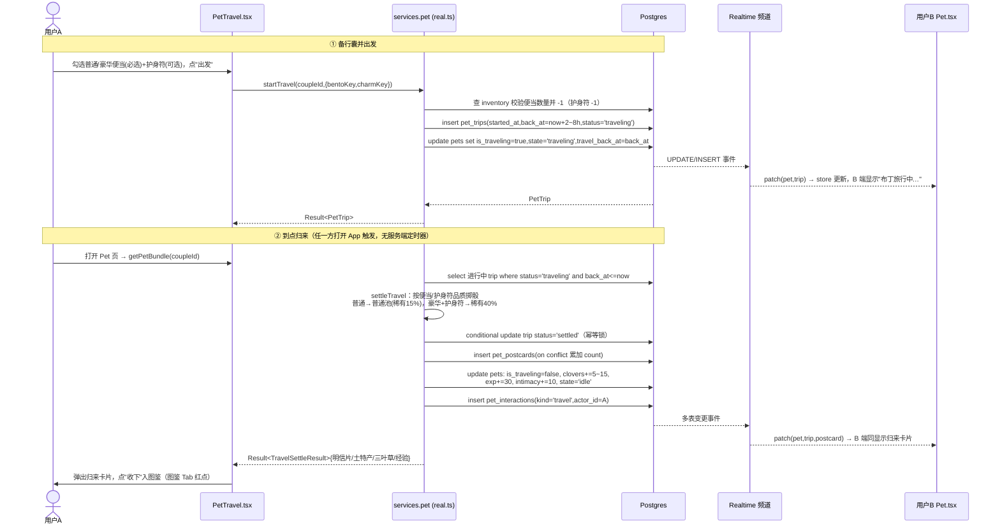
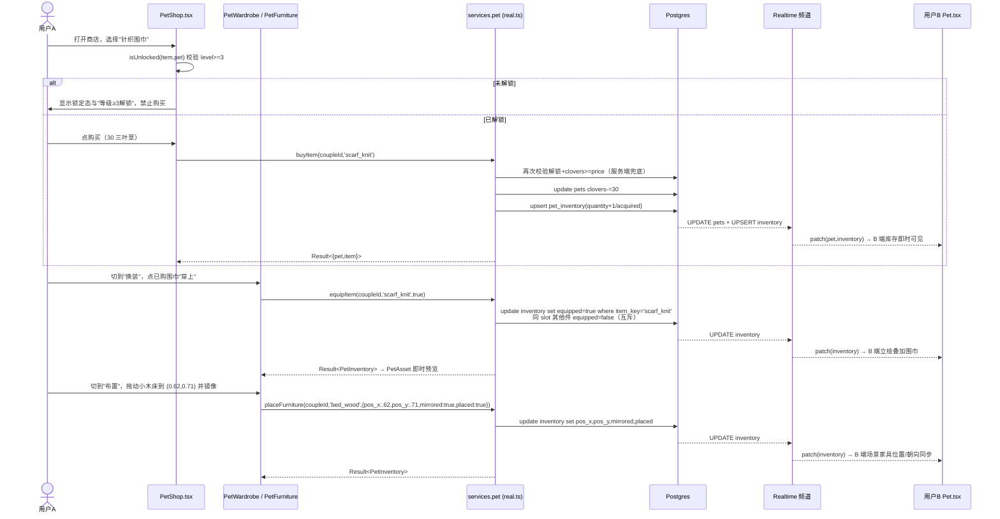

# 宠物模块重构 · 增量系统设计与 AI 素材清单（Pet v2）

> 文档版本：v2.0 ｜ 角色：架构师 高见远（Gao）· Architect ｜ 语言：简体中文
> 输入：`docs/PRD-pet-v2.md`（产品 许清楚）｜ 基线：`docs/DESIGN.md` v1.0、现有 `src/**`
> 面向：工程师。**本文只描述宠物模块的增量**，其余 7 项功能（FR-02/03/06/07/08/09/10）与 FR-01/04、PWA/APK 交付方式一律不动。

---

## 1. 增量架构说明

### 1.1 沿用原有分层（零新增架构范式）

```
Pet.tsx（容器 / 4 Tab 编排）
   ↓ 读 store、调 action
useAppStore.ts（pet 切片扩展：pet + inventory + postcards + interactions + trip）
   ↓ 只依赖抽象接口
services.pet（contracts.ts 中的 PetService，扩展方法）
   ├── mock.ts（演示模式：内存假数据 + 模拟广播 + 时间压缩）
   └── real.ts（真实模式：Supabase DB / Realtime / Storage）
          ↓
Supabase（pets 扩展列 + 5 张新表 + RLS + Realtime + pet-assets 桶）
```

- **模式判定不变**：仍以 `src/services/index.ts` 的 `isDemoMode` 为唯一入口，`services` 单例不变，页面/组件不得自行判断模式。
- **Realtime 不变**：仍在顶层 `App.tsx` 建立一次订阅；宠物增量通过 `subscribePetData(coupleId, cb)` 写回 store，页面只读取。
- **契约不变**：所有方法仍返回统一 `Result<T>`；错误仍走 `notify(error.message, 'error')`。
- **视觉基座不变**：仍用 `max-w-[480px]` 容器、MUI 主题与 `lucide-react`（`strokeWidth={1.75}`）；仅宠物场景区改用 AI 插画与治愈色板（PRD 3.2/3.3），主题 `brand.*` 不改动，避免影响其他 7 个页面。

### 1.2 宠物模块内部结构（Pet 页 4 Tab）

`Pet.tsx` 退化为**薄容器**：持有 couple/pet、挂载订阅、渲染常驻场景 `PetScene` + MUI `Tabs`（庭院/旅行/小窝/图鉴）+ 按 Tab 渲染子组件。三叶草收割入口与改名入口常驻 `PetScene`。

| Tab | 承载组件 | 职责边界 |
| --- | --- | --- |
| 庭院 | `PetYard` | 状态文案、收割、喂食/陪玩/摸摸、数值进度条 |
| 旅行 | `PetTravel` | 备行囊、出发、倒计时、归来结果卡片 |
| 小窝 | `PetRoom` + `PetFurniture` + `PetWardrobe` | 三个子分段：布置 / 换装 / 背景 |
| 图鉴 | `PetAlbum` | 明信片网格、土特产库存、大图预览 |
| 全局弹层 | `PetShop` | 四类商品购买，可由庭院/小窝唤起 |
| 基础设施 | `PetAsset` | 素材 key → URL 解析、图层叠加、背景裁切原语 |

`PetAsset` 是唯一的图片出口：所有 `` 的 `src` 由它按 `item_key` 从 `public/assets/pet/manifest.json` 解析，页面不硬编码文件名（方便后续替换/补素材）。

### 1.3 明确的隔离边界

- `photos` 相册表与 `Album.tsx` **完全不动**；明信片写独立的 `pet_postcards`。
- `Home.tsx` **仅改宠物概览卡片内部字段**（成长值→等级、增加饱食/三叶草），其余模块（天数、纪念日、快捷入口、悄悄话）代码零改动。
- 001_init.sql **仅调整 pets 两处默认值**供全新安装；存量库差异全部由 `002_pet_v2.sql` 承载，其余 9 张表与 RPC/策略不修改。

---

## 2. 文件变更清单

### 2.1 修改（9 个）

| 文件 | 一句话职责（本次改什么） |
| --- | --- |
| `src/pages/Pet.tsx` | 从单页改为「常驻场景 + 4 Tab」薄容器，只做编排与订阅挂载，业务下沉子组件。 |
| `src/types.ts` | 扩展 `Pet` 全部新字段，新增 `PetItem`/`PetInventory`/`PetTrip`/`Postcard`/`PetInteraction` 及联合类型。 |
| `src/services/contracts.ts` | 扩展 `PetService`（新增 12 方法），补充纯函数工具（等级/阶段/衰减/解锁判定）。 |
| `src/services/mock.ts` | 补齐宠物演示假数据、新方法的内存实现、模拟广播与时间压缩（旅行/衰减/三叶草）。 |
| `src/services/real.ts` | 用 Supabase 实现 `PetService` 新方法，含幂等初始化库存、归来结算与订阅。 |
| `src/store/useAppStore.ts` | pet 切片扩展：新增 inventory/postcards/interactions/trip/items 状态与 setter。 |
| `src/pages/Home.tsx` | **仅**宠物概览卡片：展示 Lv./阶段、饱食度、三叶草，图标 Cat→Frog（其余不动）。 |
| `src/index.css` | 新增治愈系动效：三叶草生长、换装淡入、家具拖动反馈、旅行柔光、归来卡片弹入。 |
| `supabase/migrations/001_init.sql` | **仅**将 `pets` 的 `species` 默认改为 `frog`、`name` 默认改为 `布丁`（新装生效）。 |

> 与任务清单一致：8 个 TS/CSS/页面 + 1 个 SQL 基础迁移 = 9 个修改文件。

### 2.2 新增 — Service 方法（在既有文件内扩展，非新文件）

`PetService` 新增 12 个方法（见 §3.3）：`getPetBundle` / `harvestClovers` / `buyItem` / `equipItem` / `placeFurniture` / `setBackground` / `startTravel` / `settleTravel` / `listPostcards` / `listInteractions` / `listItems` / `subscribePetData`。原有 `getPet`/`feed`/`interact`/`rename`/`subscribePet` 保留，其中 `feed` 语义改为消耗 1 份便当、`interact` 增加 30 分钟防刷。

### 2.3 新增 — 组件（9 个，`src/pages/pet/`）

| 文件 | 一句话职责 |
| --- | --- |
| `src/pages/pet/PetScene.tsx` | 常驻顶部场景：背景图层 + 立绘 + 服饰叠加 + 三叶草丛 + 状态气泡 + 改名入口。 |
| `src/pages/pet/PetYard.tsx` | 庭院 Tab：状态文案、三叶草收割、喂食/陪玩/摸摸、五维数值条。 |
| `src/pages/pet/PetTravel.tsx` | 旅行 Tab：便当/护身符勾选、出发、倒计时、归来结算卡片。 |
| `src/pages/pet/PetRoom.tsx` | 小窝 Tab：布置/换装/背景三个子分段的容器与解锁态渲染。 |
| `src/pages/pet/PetFurniture.tsx` | 布置子页：家具拖拽（归一化坐标）、左右镜像、收起、完成编辑。 |
| `src/pages/pet/PetWardrobe.tsx` | 换装与背景子页：同类互斥穿脱、主题背景切换与即时预览。 |
| `src/pages/pet/PetAlbum.tsx` | 图鉴 Tab：明信片网格（地点/稀有度）、土特产库存、大图预览弹窗。 |
| `src/pages/pet/PetShop.tsx` | 商店弹窗：消耗品/家具/服饰/背景分区、锁定态与价格、余额校验。 |
| `src/pages/pet/PetAsset.tsx` | 素材解析原语：key→路径、图层绝对定位叠加、CSS 滤镜变体、加载失败回退。 |

### 2.4 新增 — 数据与素材

| 文件 | 一句话职责 |
| --- | --- |
| `supabase/migrations/002_pet_v2.sql` | pets 加列 + 存量映射 + 5 张新表 + RLS + Realtime + `pet-assets` 桶 + catalog 种子。 |
| `public/assets/pet/manifest.json` | 全部素材的 `key → 路径/尺寸/锚点` 映射，P0/P1 共用，代码只认 key。 |
| `public/assets/pet/character/*.png` | 成长阶段 4 + 在家状态 3 + 旅行 1（P0），其余 P1。 |
| `public/assets/pet/background/*.png` | 庭院/星空/海边（P0），卧室/花园（P1）。 |
| `public/assets/pet/outfit/*.png` | 草帽/蝴蝶结/围巾/圆框眼镜（P0），其余 P1。 |
| `public/assets/pet/furniture/*.png` | 小木床/毛线地毯/绿植/小书架（P0），其余 P1。 |
| `public/assets/pet/postcard/*.jpg` | 樱花/灯塔/温泉（P0），其余 P1。 |
| `public/assets/pet/item/*.png` | 三叶草丛、旅行道具组（P0），其余 P1。 |

**增量变更统计**：修改 9 + 新增组件 9 + 新增数据/清单 8（SQL 1、manifest 1、素材目录 6）= **26 个文件级变更**（素材目录按目录计，实际 P0 图片 24 张）。

---

## 3. 数据结构设计

### 3.1 `supabase/migrations/002_pet_v2.sql`（完整）

```sql
-- ============================================================
-- Pet v2 增量迁移：pets 加列 + 5 张新表 + RLS + Realtime + Storage + 种子
-- 依赖 001_init.sql；可重复执行（if not exists / on conflict）。
-- ============================================================
create extension if not exists "pgcrypto";

-- ---------- (A) 修改现有表 pets ----------
alter table public.pets
  alter column species set default 'frog',
  alter column name    set default '布丁';

alter table public.pets
  add column if not exists level          int not null default 1  check (level between 1 and 10),
  add column if not exists exp            int not null default 0  check (exp >= 0),
  add column if not exists fullness       int not null default 60 check (fullness between 0 and 100),
  add column if not exists intimacy       int not null default 0  check (intimacy between 0 and 100),
  add column if not exists clovers        int not null default 10 check (clovers between 0 and 999),
  add column if not exists state          text not null default 'idle'
      check (state in ('idle','reading','eating','sleeping','writing','traveling')),
  add column if not exists is_traveling   boolean not null default false,
  add column if not exists travel_back_at timestamptz,
  add column if not exists clover_count   int not null default 0 check (clover_count between 0 and 8),
  add column if not exists last_clover_at timestamptz,
  add column if not exists last_decay_at  timestamptz not null default now(),
  add column if not exists background     text not null default 'courtyard';

-- 存量映射：仅处理旧默认值 species='cat' 的行，天然幂等；
-- 自定义名保留，仅默认值「小甜心」改为「布丁」；exp 取 stage 对应阈值保证 level 自洽，
-- 原 growth 原样保留作兼容字段（前端不再以 growth 驱动升级）。
update public.pets p set
  level   = case p.stage when 'egg' then 1 when 'baby' then 2 when 'teen' then 4 when 'adult' then 7 else 1 end,
  exp     = case p.stage when 'egg' then 0 when 'baby' then 100 when 'teen' then 300 when 'adult' then 600 else 0 end,
  species = 'frog',
  name    = case when p.name = '小甜心' then '布丁' else p.name end,
  last_decay_at  = coalesce(p.updated_at, now()),
  last_clover_at = now(),
  updated_at     = now()
where p.species = 'cat';

-- ---------- (B) 5 张新表 ----------
-- B1. catalog（全局静态）：category 扩展 postcard/souvenir 以复用同一张表，避免第 6 张表
create table if not exists public.pet_items (
  key             text primary key,
  category        text not null check (category in ('consumable','furniture','outfit','background','postcard','souvenir')),
  name            text not null,
  asset_path      text,
  slot            text,                                   -- outfit: hat / scarf / bow / glasses
  unlock_level    int not null default 1  check (unlock_level between 1 and 10),
  unlock_intimacy int not null default 0  check (unlock_intimacy between 0 and 100),
  price           int not null default 0  check (price >= 0),
  rarity          text not null default 'normal' check (rarity in ('normal','rare')),
  sort_order      int not null default 0,
  created_at      timestamptz not null default now()
);

-- B2. couple 拥有的物品 / 穿戴 / 摆放（一 couple 一 item 一行）
create table if not exists public.pet_inventory (
  id          uuid primary key default gen_random_uuid(),
  couple_id   uuid not null references public.couples(id) on delete cascade,
  item_key    text not null references public.pet_items(key) on delete cascade,
  quantity    int not null default 1 check (quantity >= 0),
  equipped    boolean not null default false,              -- 服饰
  placed      boolean not null default false,              -- 家具
  pos_x       real,                                        -- 归一化 0~1
  pos_y       real,
  mirrored    boolean not null default false,
  acquired_at timestamptz not null default now(),
  unique (couple_id, item_key)
);
create index if not exists idx_pet_inv_couple on public.pet_inventory(couple_id);

-- B3. 旅行记录（含幂等结算标记 status）
create table if not exists public.pet_trips (
  id              uuid primary key default gen_random_uuid(),
  couple_id       uuid not null references public.couples(id) on delete cascade,
  started_at      timestamptz not null default now(),
  back_at         timestamptz not null,
  bento_key       text not null references public.pet_items(key),
  charm_key       text references public.pet_items(key),
  status          text not null default 'traveling' check (status in ('traveling','settled')),
  postcard_key    text references public.pet_items(key),
  souvenir_key    text references public.pet_items(key),
  clovers_gained  int not null default 0,
  exp_gained      int not null default 0,
  settled_at      timestamptz,
  created_at      timestamptz not null default now()
);
create index if not exists idx_pet_trips_couple_status on public.pet_trips(couple_id, status, back_at);

-- B4. 明信片图鉴（重复获得累加 count，与 photos 表完全隔离）
create table if not exists public.pet_postcards (
  id           uuid primary key default gen_random_uuid(),
  couple_id    uuid not null references public.couples(id) on delete cascade,
  postcard_key text not null references public.pet_items(key),
  rarity       text not null default 'normal' check (rarity in ('normal','rare')),
  count        int not null default 1,
  trip_id      uuid references public.pet_trips(id) on delete set null,
  obtained_at  timestamptz not null default now(),
  unique (couple_id, postcard_key)
);
create index if not exists idx_pet_postcards_couple on public.pet_postcards(couple_id, obtained_at desc);

-- B5. 共享互动记录（同时服务防刷窗口与「一起养」时间线）
create table if not exists public.pet_interactions (
  id         uuid primary key default gen_random_uuid(),
  couple_id  uuid not null references public.couples(id) on delete cascade,
  actor_id   uuid not null references public.profiles(id) on delete cascade,
  kind       text not null check (kind in ('feed','play','pat','travel','harvest')),
  created_at timestamptz not null default now()
);
create index if not exists idx_pet_int_couple_time on public.pet_interactions(couple_id, created_at desc);
create index if not exists idx_pet_int_antispam    on public.pet_interactions(couple_id, actor_id, kind, created_at desc);

-- ---------- (C) RLS：统一复用 is_couple_member ----------
alter table public.pet_items       enable row level security;
alter table public.pet_inventory   enable row level security;
alter table public.pet_trips       enable row level security;
alter table public.pet_postcards   enable row level security;
alter table public.pet_interactions enable row level security;

drop policy if exists p_pet_items_read on public.pet_items;
create policy p_pet_items_read on public.pet_items for select using (true);  -- 全局 catalog 只读

drop policy if exists p_pet_inv_all on public.pet_inventory;
create policy p_pet_inv_all on public.pet_inventory for all
  using (is_couple_member(couple_id)) with check (is_couple_member(couple_id));
drop policy if exists p_pet_trip_all on public.pet_trips;
create policy p_pet_trip_all on public.pet_trips for all
  using (is_couple_member(couple_id)) with check (is_couple_member(couple_id));
drop policy if exists p_pet_pc_all on public.pet_postcards;
create policy p_pet_pc_all on public.pet_postcards for all
  using (is_couple_member(couple_id)) with check (is_couple_member(couple_id));
drop policy if exists p_pet_int_all on public.pet_interactions;
create policy p_pet_int_all on public.pet_interactions for all
  using (is_couple_member(couple_id)) with check (is_couple_member(couple_id));

-- ---------- (D) Realtime ----------
do $$ begin alter publication supabase_realtime add table public.pet_inventory;   exception when duplicate_object then null; end $$;
do $$ begin alter publication supabase_realtime add table public.pet_trips;       exception when duplicate_object then null; end $$;
do $$ begin alter publication supabase_realtime add table public.pet_postcards;   exception when duplicate_object then null; end $$;
do $$ begin alter publication supabase_realtime add table public.pet_interactions;exception when duplicate_object then null; end $$;
-- pets 已在 001_init.sql 发布，无需重复。

-- ---------- (E) Storage：pet-assets 公开读、前端只读 ----------
insert into storage.buckets (id, name, public) values ('pet-assets', 'pet-assets', true) on conflict do nothing;
drop policy if exists p_pet_assets_read on storage.objects;
create policy p_pet_assets_read on storage.objects for select using (bucket_id = 'pet-assets');
-- 刻意不建 anon insert/update/delete policy：写由 service_role / 种子脚本控制。

-- ---------- (F) catalog 种子（P0 项 + 少量土特产） ----------
insert into public.pet_items (key, category, name, asset_path, slot, unlock_level, unlock_intimacy, price, rarity, sort_order) values
 ('bento_normal','consumable','普通便当','item/bento_normal.png',null,1,0,3,'normal',10),
 ('bento_deluxe','consumable','豪华便当','item/bento_deluxe.png',null,1,0,8,'normal',11),
 ('charm','consumable','护身符','item/charm.png',null,1,0,15,'normal',12),
 ('hat_straw','outfit','草帽','outfit/hat_straw.png','hat',1,0,0,'normal',20),
 ('bow_knot','outfit','蝴蝶结','outfit/bow_knot.png','bow',1,20,20,'normal',21),
 ('scarf_knit','outfit','针织围巾','outfit/scarf_knit.png','scarf',3,0,30,'normal',22),
 ('glasses_round','outfit','圆框眼镜','outfit/glasses_round.png','glasses',4,0,35,'normal',23),
 ('bed_wood','furniture','小木床','furniture/bed_wood.png',null,1,0,0,'normal',30),
 ('rug_wool','furniture','毛线地毯','furniture/rug_wool.png',null,2,0,25,'normal',31),
 ('plant_pot','furniture','绿植盆栽','furniture/plant_pot.png',null,1,30,30,'normal',32),
 ('bookshelf','furniture','小书架','furniture/bookshelf.png',null,5,0,50,'normal',33),
 ('bg_courtyard','background','庭院小窝','background/bg_courtyard.png',null,1,0,0,'normal',40),
 ('bg_starry','background','星空夜院','background/bg_starry.png',null,6,0,60,'normal',41),
 ('bg_seaside','background','海边小屋','background/bg_seaside.png',null,1,60,60,'normal',42),
 ('pc_sakura','postcard','樱花树下的信','postcard/pc_sakura.jpg',null,1,0,0,'normal',50),
 ('pc_lighthouse','postcard','海边灯塔','postcard/pc_lighthouse.jpg',null,1,0,0,'rare',51),
 ('pc_onsen','postcard','山间温泉','postcard/pc_onsen.jpg',null,1,0,0,'normal',52),
 ('souvenir_dango','souvenir','樱花团子',null,null,1,0,5,'normal',60),
 ('souvenir_tea','souvenir','焙茶包',null,null,1,0,5,'normal',61)
on conflict (key) do nothing;
```

> **首初始化策略**：`getPetBundle` 在 inventory 为空时幂等补入 `hat_straw`（owned）、`bed_wood`（placed，pos 0.5/0.7）、`bento_normal` ×1，并给用户 10 三叶草（pets 默认值已保证）。这样无需按 couple 写 SQL 种子。

### 3.2 前端 TS 类型（`src/types.ts` 增量）

```ts
// ===== 新增联合类型 =====
export type PetItemCategory = 'consumable' | 'furniture' | 'outfit' | 'background' | 'postcard' | 'souvenir';
export type PetOutfitSlot = 'hat' | 'scarf' | 'bow' | 'glasses';
export type PetState = 'idle' | 'reading' | 'eating' | 'sleeping' | 'writing' | 'traveling';
export type PetInteractionKind = 'feed' | 'play' | 'pat' | 'travel' | 'harvest';
export type PetRarity = 'normal' | 'rare';
export type PetBackgroundKey = 'courtyard' | 'bedroom' | 'garden' | 'starry' | 'seaside';

// ===== Pet 扩展（保留 growth 兼容字段） =====
export interface Pet {
  id: ID; couple_id: ID;
  name: string; species: string;                 // 默认 '布丁' / 'frog'
  level: number; exp: number;                    // 1~10 / 累计经验
  mood: number; fullness: number; intimacy: number; clovers: number;
  stage: PetStage; state: PetState;
  is_traveling: boolean; travel_back_at: ISODate | null;
  clover_count: number; last_clover_at: ISODate | null; last_decay_at: ISODate;
  background: PetBackgroundKey;
  growth: number;                                // 兼容 v1，不再驱动升级
  last_fed_at: ISODate | null; updated_at: ISODate;
}

export interface PetItem {
  key: string; category: PetItemCategory; name: string;
  asset_path: string | null; slot: PetOutfitSlot | null;
  unlock_level: number; unlock_intimacy: number;
  price: number; rarity: PetRarity; sort_order: number;
}

export interface PetInventory {
  id: ID; couple_id: ID; item_key: string; quantity: number;
  equipped: boolean; placed: boolean;
  pos_x: number | null; pos_y: number | null; mirrored: boolean;
  acquired_at: ISODate;
}

export interface PetTrip {
  id: ID; couple_id: ID;
  started_at: ISODate; back_at: ISODate;
  bento_key: string; charm_key: string | null;
  status: 'traveling' | 'settled';
  postcard_key: string | null; souvenir_key: string | null;
  clovers_gained: number; exp_gained: number; settled_at: ISODate | null;
}

export interface Postcard {
  id: ID; couple_id: ID; postcard_key: string;
  rarity: PetRarity; count: number; trip_id: ID | null; obtained_at: ISODate;
}

export interface PetInteraction {
  id: ID; couple_id: ID; actor_id: ID;
  kind: PetInteractionKind; created_at: ISODate;
}

/** 挂载时一次性取全的聚合包，减少往返与 loading 状态。 */
export interface PetBundle {
  pet: Pet;
  items: PetItem[];
  inventory: PetInventory[];
  postcards: Postcard[];
  interactions: PetInteraction[];
  trip: PetTrip | null;        // 最近一次 traveling 中的旅行（含未结算）
}

/** 归来结算结果：广播与 UI 共用。 */
export interface TravelSettleResult {
  pet: Pet; trip: PetTrip; postcard: Postcard | null; souvenirKey: string | null;
}
```

### 3.3 `PetService` 扩展接口（`src/services/contracts.ts`）

```ts
export interface PetService {
  // ===== 原有（保留签名，语义增强） =====
  getPet(coupleId: ID): Promise<Result<Pet>>;
  feed(coupleId: ID): Promise<Result<Pet>>;                          // 消耗 1 bento_normal；饱食=100 时拒绝
  interact(coupleId: ID, kind: 'play' | 'pat'): Promise<Result<Pet>>; // 同人同类 30 分钟内仅计一次收益
  rename(coupleId: ID, name: string): Promise<Result<Pet>>;
  subscribePet(coupleId: ID, cb: (p: Pet) => void): Unsubscribe;

  // ===== 新增 12 个方法 =====
  /** 挂载时一次性拉取宠物 + catalog + 库存 + 图鉴 + 互动 + 进行中旅行（含幂等初始化与数值补算）。 */
  getPetBundle(coupleId: ID): Promise<Result<PetBundle>>;
  /** 收割庭院三叶草：按 last_clover_at 补算 0~8 株，每株 +2。 */
  harvestClovers(coupleId: ID): Promise<Result<Pet>>;
  /** 购买商品：校验解锁与余额，消耗品入 inventory.quantity，装饰入库。 */
  buyItem(coupleId: ID, itemKey: string, quantity?: number): Promise<Result<{ pet: Pet; item: PetInventory }>>;
  /** 服饰穿脱：同 slot 互斥，穿一件自动脱同槽其他件。 */
  equipItem(coupleId: ID, itemKey: string, equipped: boolean): Promise<Result<PetInventory>>;
  /** 家具摆放：pos_x/pos_y 归一化 0~1，mirrored 左右镜像，placed=false 即收起。 */
  placeFurniture(coupleId: ID, itemKey: string, patch: Pick<PetInventory, 'pos_x' | 'pos_y' | 'mirrored' | 'placed'>): Promise<Result<PetInventory>>;
  /** 切换主题背景（按解锁条件校验）。 */
  setBackground(coupleId: ID, background: PetBackgroundKey): Promise<Result<Pet>>;
  /** 出发旅行：扣除便当/护身符，写 pets.is_traveling 与 travel_back_at，返回旅行单。 */
  startTravel(coupleId: ID, input: { bentoKey: string; charmKey?: string | null }): Promise<Result<PetTrip>>;
  /** 归来结算：幂等（status traveling→settled），产出明信片/土特产/三叶草/经验，亲密度 +10。 */
  settleTravel(coupleId: ID): Promise<Result<TravelSettleResult>>;
  /** 明信片图鉴列表（按 obtained_at desc）。 */
  listPostcards(coupleId: ID): Promise<Result<Postcard[]>>;
  /** 共享互动记录（默认 50 条，倒序）。 */
  listInteractions(coupleId: ID, limit?: number): Promise<Result<PetInteraction[]>>;
  /** 静态 catalog（前端可缓存）。 */
  listItems(): Promise<Result<PetItem[]>>;
  /** 统一订阅：pets / inventory / trips / postcards / interactions 任一变化均回调。 */
  subscribePetData(coupleId: ID, cb: (patch: Partial<PetBundle>) => void): Unsubscribe;
}
```

### 3.4 纯工具函数（放 `contracts.ts`，双实现共用，避免 mock/real 漂移）

```ts
export const levelForExp   = (exp: number): number => Math.min(10, Math.floor(exp / 100) + 1);
export const expToNext     = (level: number): number => (level - 1) * 100;
export const stageForLevel = (l: number): PetStage =>
  l <= 1 ? 'egg' : l <= 3 ? 'baby' : l <= 6 ? 'teen' : 'adult';
export const isUnlocked    = (item: PetItem, pet: Pet): boolean =>
  pet.level >= item.unlock_level && pet.intimacy >= item.unlock_intimacy;
/** 按小时补算衰减；旅行中返回原值。hours = (now - last_decay_at)/3600_000 */
export const applyDecay = (mood: number, fullness: number, hours: number, traveling: boolean) =>
  traveling ? { mood, fullness } : {
    mood: Math.max(0, mood - Math.floor(hours) * 2),
    fullness: Math.max(0, fullness - Math.floor(hours) * 4),
  };
/** 三叶草生长株数：每 30 分钟 1 株，上限 8。 */
export const grownClovers = (current: number, lastAt: ISODate | null, now = Date.now()) =>
  lastAt ? Math.min(8, current + Math.floor((now - new Date(lastAt).getTime()) / 1_800_000)) : current;
```

### 3.5 关键约束

- **防刷**：`feed/play/pat` 写 `pet_interactions` 前查 `(couple_id, actor_id, kind)` 最近 30 分钟是否存在；存在则操作成功但**不重复计数值收益**（UI 提示"刚互动过，先歇会儿～"）。
- **亲密度**：仅 `feed/play/pat` 的**双方各自每日首次**互动 +2；归来固定 +10。以 `pet_interactions` 按 `date(created_at)` 判定当日首次。
- **归来幂等**：`settleTravel` 先用 `status='traveling'` 条件更新为 `settled`，`affected=0` 直接返回当前结果，避免双端同时结算重复发奖。
- **图片资产**：前端一律只读；`pet_items.asset_path` 为相对 `public/assets/pet/` 的路径，由 `PetAsset` 拼接。

---

## 4. 关键流程时序图

### 4.1 旅行出发 → 归来结算（真实模式，双端同步）



### 4.2 装饰购买 → 解锁判定 → 穿戴/摆放同步



---

## 5. 演示模式处理（`mock.ts`）

### 5.1 初始演示数据（刷新即还原，全部内存）

| 对象 | 初始值 | 说明 |
| --- | --- | --- |
| `pet` | `name='布丁'`, `species='frog'`, `level=3`, `exp=250`, `stage='teen'`, `state='reading'`, `mood=78`, `fullness=65`, `intimacy=24`, `clovers=30`, `clover_count=5`, `background='courtyard'`, `is_traveling=false` | 等级 3 使围巾已解锁；亲密度 24 使蝴蝶结已解锁（演示可立刻展示换装）。 |
| `inventory` | `hat_straw`(equipped=true)、`bed_wood`(placed=true,0.5/0.7)、`bow_knot`(owned)、`rug_wool`(owned)、`bento_normal`×3、`bento_deluxe`×1、`charm`×1 | 保证购买→穿戴→摆放三段演示连续可走；星空背景未购但已解锁（Lv.6 未达，故演示库设 level=6？取 level=3 更符合初始，星空在 P1 展示，见下）。 |
| `postcards` | 3 张：`pc_sakura`×2(normal)、`pc_lighthouse`×1(rare) | 图鉴 Tab 首屏有内容，含稀有权重标签。 |
| `interactions` | 6 条，`demo-user`/`demo-partner` 交替，kind 覆盖 feed/play/pat | "一起养"时间线可见。 |
| `items` | 同 §3.1 种子 catalog（模块级常量） | 与 real 实现同 key，切换模式不穿帮。 |

> 为让**背景切换**在演示首屏也能体验，`bg_starry` 在演示库中设为 `unlock_level=1`（仅 mock 覆盖），或演示库直接预置 `level=6, exp=520, stage='teen'` 使星空/围巾/书架同时解锁。**推荐后者**：`level=6, exp=520` 一次解锁围巾、地毯、书架、星空，蝴蝶结（intimacy=24）也可穿，四项装饰在演示模式全部可展示。

### 5.2 时间压缩与数值模拟

- **旅行等待**：真实 2–8 小时 → 演示 **2–5 分钟**（`startTravel` 写 `back_at = now + (2+rand*3) min`）。PetTravel 额外在 `demoMode` 下显示"⏩ 立即归来"按钮（直接把 `back_at` 置为 now 并触发 `settleTravel`），方便验收。
- **三叶草生长**：真实 30 分钟/株 → 演示 **60 秒/株**，上限 8；`harvestClovers` 调用 `grownClovers` 的演示变体（分母 60_000）。
- **数值衰减**：真实按小时 `-2 mood / -4 fullness` → 演示按 **1 分钟 ≈ 1 小时** 缩放，使 5 分钟内可见掉值；`is_traveling=true` 时暂停（与真实一致）。补算在每次 `getPetBundle/getPet` 前执行并更新 `last_decay_at`。
- **防刷**：演示同样执行 30 分钟窗口（真实时长，不压缩），但 UI 提示可点"立即归来"跳过后继续互动。
- **广播**：复用现有 `emitTopic`，新增 `petdata:${coupleId}` topic；每次写操作发 `emitTopic('petdata:'+coupleId)`，订阅回调 `(patch: Partial<PetBundle>)` 与 real 的 Realtime patch 形状一致。

---

## 6. 任务列表（有序、含依赖）

> 排序：**数据层 → store/service → 组件 → Pet 页整合 → 素材接入**。T03/T04 可并行，缩短关键路径。

### T01 — 数据层与契约 【P0】
- **文件（4）**：`supabase/migrations/001_init.sql`(改默认值)、`supabase/migrations/002_pet_v2.sql`(新)、`src/types.ts`(改)、`src/services/contracts.ts`(改，含纯工具函数)。
- **依赖**：无。
- **说明**：落地加列/5 表/RLS/Realtime/Storage/catalog 种子与存量映射；前端类型与 12 个新方法签名一次定义清楚。**先跑通 `tsc --noEmit` 与 SQL 在空库的无缝执行。**

### T02 — Service 双实现 + store 切片 【P0】
- **文件（3）**：`src/services/real.ts`、`src/services/mock.ts`、`src/store/useAppStore.ts`。
- **依赖**：T01。
- **说明**：`real.ts` 完成 12 方法 + 幂等初始化库存 + 归来幂等锁 + `subscribePetData` 5 表合并订阅；`mock.ts` 按 §5 补齐假数据/压缩/衰减/广播；store 增加 inventory/postcards/interactions/trip/items 状态与 setter。**两实现必须用 T01 的纯函数，禁止各自写数值公式。**

### T03 — 场景 / 庭院 / 旅行组件 【P0】
- **文件（4）**：`PetScene.tsx`、`PetYard.tsx`、`PetTravel.tsx`、`PetAsset.tsx`；配套 `src/index.css` 动效。
- **依赖**：T02。
- **说明**：实现常驻场景与两个 P0 Tab；`PetAsset` 先以「占位色块 + manifest key」跑通，素材后接。验收：演示模式能收割、喂食、出发、立即归来并看到结果卡片。

### T04 — 小窝 / 图鉴 / 商店组件 【P1】
- **文件（5）**：`PetRoom.tsx`、`PetFurniture.tsx`、`PetWardrobe.tsx`、`PetAlbum.tsx`、`PetShop.tsx`。
- **依赖**：T02（与 T03 并行）。
- **说明**：实现装饰四项完整交互与明信片图鉴；家具拖拽用 pointer 事件写归一化坐标（网格吸附 0.05），换装按 slot 互斥；所有未解锁项显示条件文案。验收：购买→解锁→穿戴/摆放→刷新保持→伴侣端同步。

### T05 — Pet 页整合 + Home 卡片 + 素材接入 【P0/P1】
- **文件/目录（3+）**：`src/pages/Pet.tsx`、`src/pages/Home.tsx`、`public/assets/pet/**`（P0 24 张 + manifest.json）。
- **依赖**：T03、T04。
- **说明**：`Pet.tsx` 装配 4 Tab 与全局订阅；`Home.tsx` **仅**替换宠物卡片字段；按 §7 生成的 P0 素材按 key 落地并替换 PetAsset 占位。验收：375px 下无溢出、透明底无白边、画风一致、演示模式完整走通养成+装饰四项。

### 6.1 任务依赖图


---

## 7.【关键】AI 素材生成清单

> **成本策略**：PRD 第 9 节 47 项 → **P0 必做 24 项**（一次成套，覆盖养成+装饰四项演示）+ **P1 可选 23 项**（后续补）。每张约 5–10 积分，P0 全套控制在约 120–240 积分。
> **生成顺序铁律**：先出 **1 张角色基准图** → 以它为参考图做 image-to-image 生成其余全部角色/服饰 → 再生成背景/明信片/道具（仅共享风格后缀）。

### 7.1 统一角色基准（所有角色图的风格锚点）

**一句话基准**：**一只 2.5 头身、圆润矮胖的薄荷绿青蛙，奶油白肚皮，大而圆的深褐圆眼带小高光，两枚椭圆蜜桃腮红，一条极浅的微笑弧线，四肢短圆，3/4 正面视角，安静佛系表情。**

**基准图 prompt（直接复制进 ImageGen，先生成 `character/_frog_base.png`，仅作参考不随包发布）**：

```text
A single cute chubby zen frog character, 2.5-head-tall chibi proportion, soft rounded
mint-green body (#BFE3CF) with a creamy pale belly (#FFF6E9), large round glossy
dark-brown eyes with tiny white catchlights, two small oval peach blush patches
(#F7C8D8), a faint gentle curved smile, short rounded limbs, calm quiet expression,
three-quarter front view facing slightly to the left, Japanese healing picture-book
watercolor illustration, low-saturation warm pastel palette (cream #FFF6E9, warm pink
#F7C8D8, mint #BFE3CF, apricot #FFD9A8, light wood #D9B38C), soft paper grain texture,
rounded edgeless forms, no outline or at most 1px warm-grey #7A6A63 line, soft diffused
light from upper left, gentle diffuse shadow, subject centered occupying 65% of canvas
with at least 10% margin, isolated on fully transparent background, no text, no border,
no watermark --ar 1:1
```

**两个可拼接公共串（下表 P0 prompt 中 `[FROG]` / `[STYLE]` 即指这两串，拼接后为完整 prompt）**：

- `[FROG]` = `the same round chubby zen frog: 2.5-head-tall, mint-green #BFE3CF body, cream #FFF6E9 belly, big round glossy dark-brown eyes with tiny white catchlights, two oval peach #F7C8D8 blushes, faint curved smile, short rounded limbs, calm expression, three-quarter front view`
- `[STYLE]` = `Japanese healing picture-book watercolor, low-saturation warm pastel palette (cream #FFF6E9, warm pink #F7C8D8, mint #BFE3CF, apricot #FFD9A8, light wood #D9B38C), soft paper grain, rounded edgeless forms, no outline or 1px warm-grey #7A6A63 line, soft diffused upper-left light, gentle diffuse shadow, no text, no watermark, no border`

**角色一致性执行法**：以 `_frog_base.png` 为 reference image，ImageGen 走 **image-to-image**（高参考强度 0.7 左右）生成 P0 的 #1–#8；服饰 #12–#15 同样以基准图为参考，但 prompt 末尾加 `the frog itself is NOT in the image, accessory only, isolated on transparent background, aligned to the same head/body anchor`，生成后只保留配件图层。

### 7.2 P0 核心素材（24 项，必须生成）

> 统一补充：`transparent background` + `watercolor` 已写入每条 prompt；角色/服饰/家具/道具 `size=1024×1024`（家具/道具可 512×512 省算力），背景 `1080×1440`，明信片 `1280×960`。`quality` 一律 **high**（透明底低质量会出现白边）。

| # | 文件（相对 `public/assets/pet/`） | ImageGen prompt（拼接 `[FROG]` / `[STYLE]` 后使用） | size | quality |
| --- | --- | --- | --- | --- |
| 1 | `character/frog_egg.png` | `A round speckled mint-cream frog egg with a faint sleeping face inside, tiny soft blush, [STYLE], centered 65%, fully transparent background, watercolor, no text` | 1024² | high |
| 2 | `character/frog_baby.png` | `[FROG] but smaller chubby baby proportions, oversized head, sitting with tiny paws together, curious soft eyes, [STYLE], fully transparent background, watercolor` | 1024² | high |
| 3 | `character/frog_teen.png` | `[FROG], sitting upright, hands resting on knees, the canonical idle pose, [STYLE], fully transparent background, watercolor` | 1024² | high |
| 4 | `character/frog_adult.png` | `[FROG] slightly larger and calmer, a tiny leaf tucked by the cheek, serene half-lidded eyes, [STYLE], fully transparent background, watercolor` | 1024² | high |
| 5 | `character/frog_reading.png` | `[FROG] holding a small open picture book with both paws, eyes lowered to the book, [STYLE], fully transparent background, watercolor` | 1024² | high |
| 6 | `character/frog_sleeping.png` | `[FROG] lying on its belly asleep, cheek on paws, tiny closed-eye arcs, faint 'z' not as text but soft dreamy bubbles, [STYLE], fully transparent background, watercolor` | 1024² | high |
| 7 | `character/frog_eating.png` | `[FROG] holding a small cream rice bowl with both paws, cheeks slightly puffed, happy closed-eye smile, [STYLE], fully transparent background, watercolor` | 1024² | high |
| 8 | `character/frog_travel.png` | `[FROG] wearing a tiny woven travel backpack, one paw waving, a small straw hat, cheerful calm expression, full body, [STYLE], fully transparent background, watercolor` | 1024² | high |
| 9 | `background/bg_courtyard.png` | `Cozy Japanese courtyard of a tiny wooden house, low wooden fence, moss stones, a clover patch, warm afternoon light, soft 2.5D slight top-down view, [STYLE] but no characters, vertical composition, watercolor, no text` | 1080×1440 | high |
| 10 | `background/bg_starry.png` | `Same cozy Japanese courtyard at night, deep soft indigo sky with small gentle stars, paper lantern glow, moonlight, calm healing mood, 2.5D slight top-down, [STYLE] but no characters, vertical, watercolor` | 1080×1440 | high |
| 11 | `background/bg_seaside.png` | `Tiny seaside wooden porch, pale sand, soft mint-blue sea and distant lighthouse, warm pastel sunset, 2.5D slight top-down, [STYLE] but no characters, vertical composition, watercolor` | 1080×1440 | high |
| 12 | `outfit/hat_straw.png` | `A small woven straw hat sized to sit on top of a chubby frog head between the eyes, warm beige, soft watercolor texture, [STYLE], accessory only, frog NOT in image, fully transparent background, aligned to head anchor, watercolor` | 1024² | high |
| 13 | `outfit/bow_knot.png` | `A soft warm-pink fabric bow knot sized for a frog's neck, gentle folds, [STYLE], accessory only, frog NOT in image, fully transparent background, aligned to neck anchor, watercolor` | 1024² | high |
| 14 | `outfit/scarf_knit.png` | `A chunky knitted scarf in muted mint and cream, looseends hanging softly, sized for a chubby frog neck, [STYLE], accessory only, frog NOT in image, fully transparent background, watercolor` | 1024² | high |
| 15 | `outfit/glasses_round.png` | `Round thin wire-frame glasses with warm-grey rims, sized to fit a frog's big round eyes, gentle highlight on lenses, [STYLE], accessory only, frog NOT in image, fully transparent background, aligned to eye anchor, watercolor` | 1024² | high |
| 16 | `furniture/bed_wood.png` | `A tiny simple light-wood bed with a cream quilt and small mint pillow, Japanese minimalist, [STYLE], fully transparent background, watercolor, no text` | 512² | high |
| 17 | `furniture/rug_wool.png` | `A small round woven wool rug, cream base with soft mint and apricot rings, slightly perspective-flattened, [STYLE], fully transparent background, watercolor` | 512² | high |
| 18 | `furniture/plant_pot.png` | `A small terracotta pot with a soft green leafy plant, a few rounded leaves, calm healing mood, [STYLE], fully transparent background, watercolor` | 512² | high |
| 19 | `furniture/bookshelf.png` | `A tiny low wooden bookshelf with a few pastel picture books and a small vase, [STYLE], fully transparent background, watercolor, no text` | 512² | high |
| 20 | `postcard/pc_sakura.jpg` | `Hand-drawn travel postcard front: a gentle sakura tree in bloom beside a quiet path, soft pink petals, a small wooden bench, wide hand-painted white border frame, [STYLE], flat front view, watercolor, no text` | 1280×960 | high |
| 21 | `postcard/pc_lighthouse.jpg` | `Hand-drawn travel postcard front: a small white lighthouse on a mint-blue sea cliff at golden hour, gentle waves, wide hand-painted white border frame, [STYLE], flat front view, watercolor, no text` | 1280×960 | high |
| 22 | `postcard/pc_onsen.jpg` | `Hand-drawn travel postcard front: a quiet mountain hot spring with steam and smooth stones, a tiny bamboo fence, warm apricot light, wide hand-painted white border frame, [STYLE], flat front view, watercolor` | 1280×960 | high |
| 23 | `item/clover_patch.png` | `A small clover patch of eight rounded three-leaf clovers in soft mint green with tiny cream flowers, [STYLE], fully transparent background, watercolor, no text` | 512² | high |
| 24 | `item/props_travel_sheet.png` | `A horizontal row of three separate travel props on transparent background, evenly spaced and non-overlapping: (1) plain rice bento box with cream cloth, (2) deluxe bento box with a small pink ribbon, (3) a simple cream fabric charm with a tiny mint knot, [STYLE], flat front view, watercolor, no text` | 1024² | high |

> **#24 用法**：三格横排精灵图，前端 `PetAsset` 用 `background-size:300% 100%` + `background-position: 0/50%/100%` 裁切出普通便当/豪华便当/护身符，一张图顶三张，省约 10–20 积分。土特产用 `souvenir_dango`/`souvenir_tea` 的 key + emoji（🍡/🍵）占位，P1 再补实体图。

### 7.3 P1 可选素材（23 项，后续补）

| 类别 | 文件建议 | 简要 prompt（同样拼 `[STYLE]`，透明底/水彩） | 数量 |
| --- | --- | --- | --- |
| 角色 | `frog_writing.png` / `frog_idle.png` / `frog_happy.png` / `frog_travel_return.png` | `[FROG] writing a letter / staring out the window / eyes-closed big smile / waving with a little souvenir bag` | 4 |
| 背景 | `bg_bedroom.png` / `bg_garden.png` | `cozy tiny tatami bedroom / flower garden with wooden arch, same soft 2.5D style, no characters` | 2 |
| 服饰 | `hat_knit.png` / `sunglasses.png` / `flower_wreath.png` / `bowtie.png` | `accessory only, frog NOT in image, same head/neck anchor, warm pastel watercolor, transparent` | 4 |
| 家具 | `toy_ball.png` / `lantern.png` / `tea_table.png` / `swing.png` | `tiny round fabric ball / paper lantern / low tea table / rope swing, [STYLE], transparent` | 4 |
| 明信片 | `pc_shrine.jpg` / `pc_bamboo.jpg` / `pc_snow.jpg` / `pc_town.jpg` / `pc_starry_grassland.jpg` | `hand-drawn travel postcard with wide white border: torii shrine / bamboo grove / snowy mountain / old town street / starry grassland, [STYLE]` | 5 |
| 道具 | `bento_normal.png` / `bento_deluxe.png` / `charm.png` / `souvenir_parcel.png` | 若 P0 精灵图裁切效果不理想，则拆为单图；另加 `a small wrapped souvenir parcel with a mint ribbon` | 4 |
| **合计** | | | **23** |

> 24 (P0) + 23 (P1) = **47**，与 PRD 第 9 节完全对齐，仅做优先级重排与 3 合 1 优化。

### 7.4 成套一致性策略（必读）

1. **基准先行**：先生成 `_frog_base.png` 并人工确认五官/体色，作为唯一风格锚点；不合意就重生成基准，**不要在错误基准上批量生成**。
2. **image-to-image 传递**：#1–#8 角色、#12–#15 服饰均以基准图为参考图（高参考强度）；每次生成后与基准并排比对眼睛间距、腮红位置、体色。
3. **风格串锁定**：背景/明信片/道具不出现角色，仅复用 `[STYLE]`（同一色板 + 同一左上柔光），避免出现"第二只青蛙"。
4. **后处理统一**：用脚本统一裁边至规定画布、主体占 60–70%、四周≥10% 留白；导出 PNG-24（无白边）/ JPG 明信片；在 `#FFF6E9` 底上检查透明边缘。
5. **manifest 登记**：每张图生成后立刻写入 `public/assets/pet/manifest.json`（key、path、anchor、size），工程师只按 key 取图，后续替换素材零改代码。

### 7.5 存储路径

```
public/assets/pet/
├── manifest.json
├── character/   _frog_base.png(参考,不发布), frog_egg/baby/teen/adult.png, frog_reading/sleeping/eating/travel.png
├── background/  bg_courtyard/starry/seaside.png  (+P1 bedroom/garden)
├── outfit/      hat_straw/bow_knot/scarf_knit/glasses_round.png (+P1)
├── furniture/   bed_wood/rug_wool/plant_pot/bookshelf.png (+P1)
├── postcard/    pc_sakura/lighthouse/onsen.jpg (+P1)
└── item/        clover_patch.png, props_travel_sheet.png (+P1)
```
> 同时创建 Supabase `pet-assets` 公开读桶作为后续 CDN 托管位；**本期运行时只读本地 `public/`**，不依赖桶，离线演示同样可展示。

### 7.6 最少素材做丰富效果（优化建议）

- **图层叠加**：服饰只做透明配件（4 张）叠在 1 张基准立绘上，`PetAsset` 用绝对定位 + 百分比锚点，N 套穿搭 ≈ 4 张图而非 4×N 套立绘。
- **CSS 滤镜派生背景**：从 3 张背景用 `filter: hue-rotate()/brightness()/saturate()` + 渐变遮罩派生"黄昏/清晨/雨天"变体，P1 前不额外生成。
- **镜像复用**：家具 `transform: scaleX(-1)` 实现左右朝向，无需双份素材；`placeFurniture.mirrored` 直接驱动。
- **明信片换框复用**：3 张风景 × 稀有/普通两套 CSS 边框（稀有加暖金描边 + 微光），即可撑起 8 个图鉴槽位的视觉差异。
- **状态微调**：`frog_teen` 叠加 CSS `brightness(.92)` + 一片 leaf/书 的小 PNG 即可过渡出新的在家状态，P0 只做 3 个高频状态。
- **精灵图裁切**：道具 3 合 1（#24）；体积上统一转 WebP（透明 WebP 保留 alpha）并按需懒加载非当前 Tab 的图片，减少首屏流量。

---

## 8. 共享约定与待明确事项

### 8.1 共享约定（工程师必读）

- **返回包**：全部方法 `{data,error}`，`error` 由页面 `notify` 统一呈现；禁止在组件写 Supabase 调用。
- **时间**：一律 ISO 8601 UTC 存储，`date-fns` + `zhCN` 本地化展示；防刷/每日首次按 UTC 日期判定。
- **隔离**：所有新表以 `couple_id` + `is_couple_member` 隔离；`pet_items` 为全局只读 catalog。
- **单一数值源**：升级/阶段/衰减/解锁/三叶草公式只用 §3.4 纯函数，mock 与 real 共用，防止双实现漂移。
- **阶段口径变更**：`stage` 由 **level** 映射（`stageForLevel`），`growth` 仅兼容保留；Home/Pet 显示等级不显示成长值。
- **资产口径**：前端只认 `item_key` → `manifest.json`；素材缺失回退到 `PetAsset` 的占位色块 + emoji，绝不出现破图。
- **Realtime 约定**：`subscribePet` 保留（单 pet 更新），新增 `subscribePetData` 承担全量 patch；二者底层分别对应 `pet:${id}` 与 `petdata:${id}` topic，App.tsx 只挂一次。
- **其他功能红线**：不修改 `Album.tsx`/`photos`、不修改聊天/定位/纪念日/心愿/留言/配对任何代码与表。

### 8.2 待明确事项（均已给可落地默认，不阻塞开工）

| # | 事项 | 本文默认方案 |
| --- | --- | --- |
| 1 | 物种/默认名最终确认 | 青蛙 +「布丁」，自定义名保留（PRD 3.1 已决策）。 |
| 2 | 服饰叠加方式 | 透明 PNG 图层叠加（非整套装立绘），见 §7.6。 |
| 3 | 旅行时长 | 真实 2–8h；演示 2–5min + "立即归来"按钮。 |
| 4 | 三叶草速率 | 真实 30min/株上限 8；演示 60s/株。 |
| 5 | 明信片归属 | 独立 `pet_postcards`，**不写** `photos`。 |
| 6 | 亲密度口径 | couple 共享单值，双方每日各首次互动 +2，归来 +10。 |
| 7 | 素材托管 | 本地 `public/assets/pet/` 为主，`pet-assets` 桶为后续可选。 |
| 8 | 家具摆放交互 | 自由拖拽 + 0.05 网格吸附 + 左右镜像；若产品要求更简单可退化预设槽位（改 `pos_x/pos_y` 枚举即可）。 |
| 9 | 归来推送（PET-17） | 本期不做（P2），仅 App 内 Snackbar + 图鉴红点。 |
| 10 | 旧数据迁移 | 自定义名一律保留，仅默认值「小甜心」→「布丁」；`growth` 保留不删。 |
| 11 | 精灵图接受度（新增） | 道具 3 合 1 若裁切效果不佳，P1 拆单图（接口 key 不变）。 |
| 12 | 归来并发结算（新增） | 以 `trip.status` 条件更新做幂等锁，双端同时到点只发一次奖。 |
| 13 | ImageGen 批次配额（新增） | 先生成基准图 + P0 24 项；P1 待验收后按预算分批补。 |

> 以上默认均不影响 P0/P1 验收；若产品决策变化，改动集中在 `002_pet_v2.sql` 的 catalog 种子与 `contracts.ts` 的纯函数，组件层无需改动。
