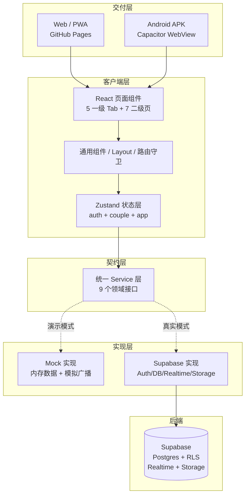
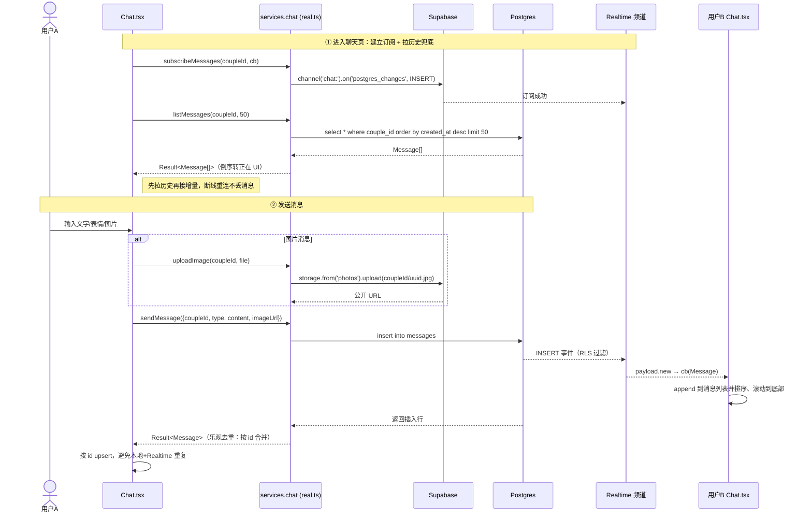
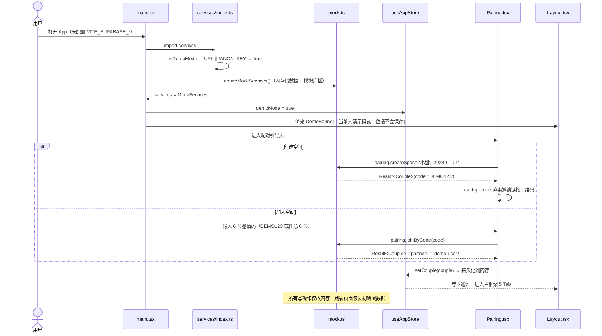
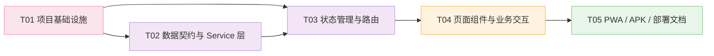

# Couple Space 系统架构设计与任务分解

> 文档版本：v1.0 ｜ 角色：架构师 高见远（Gao）· Architect ｜ 语言：简体中文
> 输入依据：`docs/PRD.md`（产品经理 许清楚）｜ 面向对象：工程师（一次性交付实现）
> 项目标识：`couple_space` ｜ 部署标识：`couple-space`（GitHub Pages 子路径）

---

## 0. 架构总览



**核心设计决策**：在 Service 层用「运行时模式开关」隔离所有后端差异。页面、组件、状态层**只依赖抽象接口**，永远不直接 import `@supabase/supabase-js`。因此「配置密钥 = 真实模式，未配置 = 演示模式」对上层完全透明，切换零改动。

---

## 1. 实现方案与框架选型

### 1.1 核心技术难点

| 难点 | 解决方案 |
| --- | --- |
| 演示模式与真实模式无缝切换 | 统一 `Service` 接口 + 双实现（`real.ts` / `mock.ts`）+ 工厂 `index.ts` 按环境变量选择；上层无感知 |
| 实时双向同步且断线不丢消息 | Supabase Realtime `postgres_changes` 订阅 + 组件挂载时全量拉取历史做兜底；Realtime 只做增量推送 |
| 只有两人能访问 private 数据 | Postgres RLS + `is_couple_member()` helper + Storage 路径前缀校验，前端不做安全假设 |
| GitHub Pages 子路径 + 无服务端回退 | Vite `base` 可配置 + **HashRouter**（`#/chat`），彻底避免 404 |
| Web / PWA / APK 一套代码 | Capacitor 直接加载 Vite 的 `dist` 静态产物；PWA 用原生 manifest + Service Worker，不引入额外插件 |
| 视觉统一与移动端 375px 无溢出 | MUI 主题集中管理配色/圆角/阴影；Tailwind 负责布局工具类；全局 `max-w-[480px]` 居中容器 |

### 1.2 框架与库选型

- **Vite 5**：构建快、配置简单、`base` 字段天然支持 Pages 子路径。
- **React 18 + TypeScript**：函数组件 + Hooks，类型覆盖数据模型与接口。
- **MUI 5**：组件库基座，主题统一（`createTheme`），Emotion 为必需 peer 依赖。
- **Tailwind CSS 3**：仅用于布局/间距/响应式快捷类，与 MUI 共存（关闭 Tailwind preflight 避免覆盖 MUI 样式）。
- **Zustand 4**：轻量状态管理，无需 Provider，适合 `auth`/`couple`/`demo` 三个全局切片。
- **react-router-dom 6（HashRouter）**：静态托管零回退配置。
- **@supabase/supabase-js 2**：Auth / Postgres / Realtime / Storage 一体化。
- **lucide-react**：成套线性图标，统一 `strokeWidth={1.75}`、尺寸 20/24。
- **react-qr-code**：生成配对二维码；条码/二维码扫描在 Web 端用 `BarcodeDetector`（渐进增强，不支持时回退手动输入邀请码）。
- **date-fns**：在一起天数、倒计时、连续打卡天数计算。

### 1.3 状态管理与架构模式

采用 **分层单向数据流**：

```
页面组件 → Zustand action → Services 接口 → (Mock | Supabase) → 状态回写 → 组件重渲染
```

- **不引入 Redux / Context 嵌套**：Zustand 三个 store 足够，且可在非 React 环境（service 回调）直接调用。
- **数据访问层（DAL）**：`src/services/` 即 DAL，全部返回统一 `Result<T>`，不在组件里写 Supabase 调用。
- **Realtime 订阅归属**：在顶层 `App.tsx` 建立一次订阅，把增量写回 Zustand；页面只做读取，避免重复订阅。

### 1.4 演示模式切换机制（重点）

```ts
// src/services/index.ts —— 唯一的模式判定入口
export const isDemoMode =
  !import.meta.env.VITE_SUPABASE_URL ||
  !import.meta.env.VITE_SUPABASE_ANON_KEY;

export const services: CoupleServices = isDemoMode
  ? createMockServices()
  : createRealServices();
```

规则：

1. 任一环境变量缺失 → 演示模式；两者齐全 → 真实模式。
2. `mock.ts` 用模块级内存对象保存假数据（聊天/相册/宠物/纪念日/心愿/留言/定位），模拟 150~300ms 延迟与 `Set<Callback>` 广播，行为与 Realtime 一致。
3. 演示模式的 `auth.signIn/signUp` 直接返回固定假 session；`pairing.joinByCode` 接受任意 6 位码（推荐 `DEMO123`）；`createSpace` 返回固定 couple。
4. 所有 mock 写操作**只改内存，刷新即还原**，并在顶部显示 `DemoBanner` 提示条。
5. 真实模式下 Supabase 调用失败会返回 `Result.error`；由 `ProtectedRoute` 与页面统一处理，不回退到 mock（避免脏数据混淆）。

### 1.5 Capacitor 打包要点

- `capacitor.config.ts`：`appId: 'com.couplespace.app'`，`webDir: 'dist'`，`server.androidScheme: 'https'`。
- 流程：`npm run build` → `npx cap sync android` → `npx cap open android`（Android Studio 打 APK）。
- 地理定位在 APK 中走 Capacitor 原生权限：需在 `AndroidManifest.xml` 声明 `ACCESS_COARSE_LOCATION`，并在运行时申请；service 内用 `navigator.geolocation` 统一封装，Web/APK 共用。
- 二维码扫码：Web 用 `BarcodeDetector`；APK 可后续接入 `@capacitor-community/barcode-scanner`，本期以手动输入邀请码为可靠兜底。

### 1.6 PWA 配置要点

- `public/manifest.webmanifest`：`display: standalone`、`theme_color: #F48FB1`、`start_url: /couple-space/`，提供 192/512 图标。
- `public/sw.js`：预缓存 `index.html` 与构建产物（安装时缓存核心 shell），对同源 GET 请求走 cache-first；**演示模式数据内置于 JS 包，因此离线可完整展示**。
- `index.html` 引入 manifest 与主题色 meta；`src/main.tsx` 注册 Service Worker（仅 `production`）。

---

## 2. 完整文件列表与相对路径（共 42 个）

### 2.1 根目录配置（9）

| 文件 | 职责 |
| --- | --- |
| `package.json` | 依赖声明与 `dev/build/preview/cap:sync` 脚本 |
| `vite.config.ts` | Vite 配置：`base` 子路径、React 插件、端口 |
| `tsconfig.json` | TypeScript 编译选项（strict、别名 `@/*`） |
| `tailwind.config.ts` | Tailwind 扫描路径、品牌色扩展、关闭 preflight |
| `postcss.config.js` | Tailwind + autoprefixer 处理链 |
| `index.html` | 入口 HTML，含 manifest、主题色、viewport meta |
| `.env.example` | `VITE_SUPABASE_URL` / `VITE_SUPABASE_ANON_KEY` / `VITE_BASE_PATH` 样例 |
| `.gitignore` | 忽略 node_modules/dist/.env/android-build 等 |
| `capacitor.config.ts` | Capacitor appId / webDir / 平台配置 |

### 2.2 应用入口与全局样式（5）

| 文件 | 职责 |
| --- | --- |
| `src/main.tsx` | React 挂载、主题注入、Service Worker 注册 |
| `src/App.tsx` | 顶层路由容器、全局 Realtime 订阅初始化、DemoBanner |
| `src/index.css` | Tailwind 指令 + 全局滚动条/动画/撒糖特效样式 |
| `src/theme.ts` | MUI 主题：配色、圆角、阴影、组件默认 props |
| `src/types.ts` | 全部业务实体 TS 类型与 `Result<T>` 公共类型 |

### 2.3 Service 数据层（7）

| 文件 | 职责 |
| --- | --- |
| `supabase/migrations/001_init.sql` | 全部表 DDL、索引、RLS 策略、Realtime 发布、Storage 桶 |
| `src/services/supabaseClient.ts` | 创建并导出 Supabase client（未配置时返回 null） |
| `src/services/contracts.ts` | 9 个领域 Service 接口 + `CoupleServices` 聚合接口 |
| `src/services/index.ts` | 模式判定、服务工厂、导出全局 `services` 单例 |
| `src/services/real.ts` | 基于 Supabase 的真实实现（含 Realtime/Storage） |
| `src/services/mock.ts` | 内存假数据实现 + 模拟广播（演示模式全功能可交互） |

> 共 6 个源文件 + 1 个 SQL 迁移。

### 2.4 状态与路由（3）

| 文件 | 职责 |
| --- | --- |
| `src/store/useAuthStore.ts` | 会话、登录/注册/登出、用户资料 |
| `src/store/useAppStore.ts` | 当前 couple、配对状态、演示模式标记、全局提示 snackbar |
| `src/router.tsx` | HashRouter 路由表、ProtectedRoute/PairRoute 守卫 |

### 2.5 通用组件（4）

| 文件 | 职责 |
| --- | --- |
| `src/components/Layout.tsx` | 底部 5 Tab 导航 + 顶部 AppBar + 480px 居中容器 |
| `src/components/Common.tsx` | 通用卡片、按钮、加载态、空状态、图片预览、倒计时 chip |
| `src/components/ProtectedRoute.tsx` | 登录/配对守卫，未登录跳 Login、未配对跳 Pairing |
| `src/components/DemoBanner.tsx` | 演示模式顶部醒目提示条 |

### 2.6 页面组件（12）

| 文件 | 职责 |
| --- | --- |
| `src/pages/Home.tsx` | 首页：在一起天数、宠物概览、纪念日倒计时、快捷入口（FR-07） |
| `src/pages/Chat.tsx` | 聊天：消息流、文字/图片/表情输入、图片预览（FR-03） |
| `src/pages/Album.tsx` | 相册：照片墙、时间轴倒序、上传、大图预览（FR-06） |
| `src/pages/Pet.tsx` | 宠物：形象、喂食/互动、成长值/心情值、阶段（FR-05） |
| `src/pages/Mine.tsx` | 我的：配对信息/邀请码/二维码、定位开关、二级入口 |
| `src/pages/Login.tsx` | 登录/注册、演示模式进入提示（FR-01/FR-04） |
| `src/pages/Pairing.tsx` | 配对引导：创建空间（邀请码/二维码）/ 加入空间（FR-02） |
| `src/pages/Anniversary.tsx` | 在一起天数设置、纪念日增删改、倒计时（FR-07） |
| `src/pages/Wishlist.tsx` | 心愿清单、每日打卡、连续天数、共同进度（FR-09） |
| `src/pages/Whispers.tsx` | 悄悄话留言/心情日记、撒糖动效（FR-10） |
| `src/pages/Location.tsx` | 双方位置卡片、最后更新时间、共享开关与授权说明（FR-08） |
| `src/pages/Settings.tsx` | 账号信息、PWA 安装引导、通知设置、退出登录 |

### 2.7 PWA 与文档（3）

| 文件 | 职责 |
| --- | --- |
| `public/manifest.webmanifest` | PWA 应用名称、图标、启动参数、主题色 |
| `public/sw.js` | Service Worker：预缓存静态资源、离线回退 |
| `README.md` | 本地运行、Supabase 配置、SQL 执行、Pages 部署、APK 打包说明 |

---

## 3. 数据结构与接口设计

### 3.1 Supabase 数据库 DDL（`supabase/migrations/001_init.sql`）

```sql
-- ============ 扩展 ============
create extension if not exists "pgcrypto";

-- ============ 1. profiles（用户档案，与 auth.users 1:1）============
create table public.profiles (
  id         uuid primary key references auth.users(id) on delete cascade,
  email      text not null,
  nickname   text not null default '恋人',
  avatar_url text,
  couple_id  uuid,                      -- 所属 couple，外键稍后补（避免循环依赖）
  created_at timestamptz not null default now()
);

-- ============ 2. couples（情侣空间，最多 2 人）============
create table public.couples (
  id         uuid primary key default gen_random_uuid(),
  code       text not null unique,                 -- 6 位邀请码
  partner1   uuid not null references public.profiles(id) on delete cascade,
  partner2   uuid references public.profiles(id) on delete set null,
  start_date date not null default current_date,   -- 在一起起始日
  created_at timestamptz not null default now(),
  constraint partners_distinct check (partner1 is distinct from partner2)
);

alter table public.profiles
  add constraint fk_profiles_couple
  foreign key (couple_id) references public.couples(id) on delete set null;

-- ============ 成员判定 helper（RLS 复用）============
create or replace function public.is_couple_member(couple_uuid uuid)
returns boolean language sql security definer stable set search_path = public as $$
  select exists (
    select 1 from public.profiles
    where id = auth.uid() and couple_id = couple_uuid
  );
$$;

-- ============ 3. messages（聊天消息）============
create table public.messages (
  id         uuid primary key default gen_random_uuid(),
  couple_id  uuid not null references public.couples(id) on delete cascade,
  sender_id  uuid not null references public.profiles(id) on delete cascade,
  type       text not null check (type in ('text','image','emoji')),
  content    text not null default '',
  image_url  text,
  created_at timestamptz not null default now()
);
create index idx_messages_couple_time on public.messages(couple_id, created_at desc);

-- ============ 4. pets（共同宠物，一 couple 一只）============
create table public.pets (
  id          uuid primary key default gen_random_uuid(),
  couple_id   uuid not null unique references public.couples(id) on delete cascade,
  name        text not null default '小甜心',
  species     text not null default 'cat',
  growth      int not null default 0 check (growth between 0 and 1000),
  mood        int not null default 70 check (mood between 0 and 100),
  stage       text not null default 'baby' check (stage in ('egg','baby','teen','adult')),
  last_fed_at timestamptz,
  updated_at  timestamptz not null default now()
);

-- ============ 5. photos（共享相册）============
create table public.photos (
  id          uuid primary key default gen_random_uuid(),
  couple_id   uuid not null references public.couples(id) on delete cascade,
  uploader_id uuid not null references public.profiles(id) on delete cascade,
  url         text not null,
  caption     text,
  created_at  timestamptz not null default now()
);
create index idx_photos_couple_time on public.photos(couple_id, created_at desc);

-- ============ 6. anniversaries（纪念日）============
create table public.anniversaries (
  id         uuid primary key default gen_random_uuid(),
  couple_id  uuid not null references public.couples(id) on delete cascade,
  title      text not null,
  date       date not null,
  type       text not null default 'anniversary' check (type in ('anniversary','birthday','other')),
  created_at timestamptz not null default now()
);

-- ============ 7. wishes + wish_checkins（心愿与打卡）============
create table public.wishes (
  id         uuid primary key default gen_random_uuid(),
  couple_id  uuid not null references public.couples(id) on delete cascade,
  title      text not null,
  done       boolean not null default false,
  created_by uuid not null references public.profiles(id) on delete cascade,
  created_at timestamptz not null default now()
);
create table public.wish_checkins (
  id           uuid primary key default gen_random_uuid(),
  wish_id      uuid not null references public.wishes(id) on delete cascade,
  user_id      uuid not null references public.profiles(id) on delete cascade,
  checkin_date date not null default current_date,
  unique (wish_id, user_id, checkin_date)
);

-- ============ 8. whispers（悄悄话/心情日记）============
create table public.whispers (
  id         uuid primary key default gen_random_uuid(),
  couple_id  uuid not null references public.couples(id) on delete cascade,
  author_id  uuid not null references public.profiles(id) on delete cascade,
  content    text not null,
  mood       text not null default 'sweet' check (mood in ('happy','sweet','calm','sad','excited')),
  created_at timestamptz not null default now()
);

-- ============ 9. locations（位置共享，一 couple 一行）============
create table public.locations (
  couple_id  uuid primary key references public.couples(id) on delete cascade,
  user_id    uuid not null references public.profiles(id) on delete cascade,
  lat        double precision not null,
  lng        double precision not null,
  accuracy   int,
  sharing    boolean not null default true,
  updated_at timestamptz not null default now()
);
```

配对 RPC（保证加入操作原子性，避免并发超额）：

```sql
create or replace function public.create_couple(p_nickname text, p_start date default current_date)
returns public.couples language plpgsql security definer set search_path = public as $$
declare v_code text; v_couple public.couples;
begin
  if exists (select 1 from profiles where id = auth.uid() and couple_id is not null) then
    raise exception 'ALREADY_PAIRED';
  end if;
  loop
    v_code := upper(substr(md5(random()::text || clock_timestamp()::text), 1, 6));
    exit when not exists (select 1 from couples where code = v_code);
  end loop;
  update profiles set nickname = coalesce(p_nickname, nickname) where id = auth.uid();
  insert into couples(code, partner1, start_date) values (v_code, auth.uid(), p_start) returning * into v_couple;
  update profiles set couple_id = v_couple.id where id = auth.uid();
  return v_couple;
end $$;

create or replace function public.join_couple(p_code text)
returns public.couples language plpgsql security definer set search_path = public as $$
declare v_couple public.couples;
begin
  if exists (select 1 from profiles where id = auth.uid() and couple_id is not null) then
    raise exception 'ALREADY_PAIRED';
  end if;
  select * into v_couple from couples where code = upper(p_code) for update;
  if not found then raise exception 'CODE_NOT_FOUND'; end if;
  if v_couple.partner2 is not null then raise exception 'COUPLE_FULL'; end if;
  if v_couple.partner1 = auth.uid() then raise exception 'SELF_JOIN'; end if;
  update couples set partner2 = auth.uid() where id = v_couple.id;
  update profiles set couple_id = v_couple.id where id = auth.uid();
  v_couple.partner2 := auth.uid();
  return v_couple;
end $$;
```

RLS 策略要点：

```sql
alter table public.profiles      enable row level security;
alter table public.couples       enable row level security;
alter table public.messages      enable row level security;
alter table public.pets          enable row level security;
alter table public.photos        enable row level security;
alter table public.anniversaries enable row level security;
alter table public.wishes        enable row level security;
alter table public.wish_checkins enable row level security;
alter table public.whispers      enable row level security;
alter table public.locations     enable row level security;

-- profiles：本人可见/可改；同一 couple 的伴侣可读昵称头像
create policy p_profile_self on public.profiles for all
  using (id = auth.uid()) with check (id = auth.uid());
create policy p_profile_partner on public.profiles for select
  using (couple_id is not null and couple_id = (select couple_id from profiles where id = auth.uid()));

-- couples：仅本 couple 成员可读；创建/更新走 RPC（security definer 绕过 RLS）
create policy p_couple_read on public.couples for select
  using (is_couple_member(id));

-- 业务表统一模板（以 messages 为例，其余表同构）
create policy p_msg_all on public.messages for all
  using (is_couple_member(couple_id)) with check (is_couple_member(couple_id));
-- pets/photos/anniversaries/wishes/whispers/locations 依此模板建 policy
-- wish_checkins 需额外通过 wish 表反查 couple_id：
create policy p_checkin_all on public.wish_checkins for all
  using (exists (select 1 from wishes w where w.id = wish_id and is_couple_member(w.couple_id)))
  with check (exists (select 1 from wishes w where w.id = wish_id and is_couple_member(w.couple_id)));

-- Realtime 发布
alter publication supabase_realtime add table public.messages;
alter publication supabase_realtime add table public.pets;
alter publication supabase_realtime add table public.wishes;
alter publication supabase_realtime add table public.whispers;
alter publication supabase_realtime add table public.locations;

-- Storage：公开读、按 couple 前缀限制写
insert into storage.buckets (id, name, public) values ('photos', 'photos', true) on conflict do nothing;
create policy p_photo_read on storage.objects for select using (bucket_id = 'photos');
create policy p_photo_write on storage.objects for insert with check (
  bucket_id = 'photos' and
  is_couple_member(((storage.foldername(name))[1])::uuid)
);
```

### 3.2 前端核心 TypeScript 类型（`src/types.ts`）

```ts
export type ID = string;
export type ISODate = string;              // ISO 8601 UTC
export type MessageType = 'text' | 'image' | 'emoji';
export type PetStage = 'egg' | 'baby' | 'teen' | 'adult';
export type MoodTag = 'happy' | 'sweet' | 'calm' | 'sad' | 'excited';
export type AnniversaryType = 'anniversary' | 'birthday' | 'other';

/** 统一返回包，贴近 Supabase 风格 */
export type Result<T> =
  | { data: T; error: null }
  | { data: null; error: { message: string; code?: string } };

export interface AppError { message: string; code?: string }
export type Unsubscribe = () => void;

export interface Profile {
  id: ID; email: string; nickname: string;
  avatar_url: string | null; couple_id: ID | null; created_at: ISODate;
}
export interface Couple {
  id: ID; code: string; partner1: ID; partner2: ID | null;
  start_date: string; created_at: ISODate;
}
export interface Message {
  id: ID; couple_id: ID; sender_id: ID; type: MessageType;
  content: string; image_url: string | null; created_at: ISODate;
}
export interface Pet {
  id: ID; couple_id: ID; name: string; species: string;
  growth: number; mood: number; stage: PetStage;
  last_fed_at: ISODate | null; updated_at: ISODate;
}
export interface Photo {
  id: ID; couple_id: ID; uploader_id: ID;
  url: string; caption: string | null; created_at: ISODate;
}
export interface Anniversary {
  id: ID; couple_id: ID; title: string; date: string;
  type: AnniversaryType; created_at: ISODate;
}
export interface Wish {
  id: ID; couple_id: ID; title: string; done: boolean;
  created_by: ID; created_at: ISODate;
}
export interface WishCheckin {
  id: ID; wish_id: ID; user_id: ID; checkin_date: string;
}
export interface Whisper {
  id: ID; couple_id: ID; author_id: ID;
  content: string; mood: MoodTag; created_at: ISODate;
}
export interface LocationShare {
  couple_id: ID; user_id: ID; lat: number; lng: number;
  accuracy: number | null; sharing: boolean; updated_at: ISODate;
}
/** 应用会话（兼容真实 Supabase Session 与演示假会话） */
export interface AppSession {
  user: { id: ID; email: string; nickname?: string };
  access_token: string;
}
```

### 3.3 Service 层接口契约（`src/services/contracts.ts`）

```ts
import type {
  Result, Unsubscribe, ID, AppSession, Profile, Couple, Message, Pet,
  Photo, Anniversary, Wish, WishCheckin, Whisper, LocationShare,
  MessageType, MoodTag, AnniversaryType,
} from '@/types';

export interface AuthService {
  signUp(email: string, password: string, nickname: string): Promise<Result<AppSession>>;
  signIn(email: string, password: string): Promise<Result<AppSession>>;
  signOut(): Promise<Result<void>>;
  getSession(): Promise<AppSession | null>;
  getProfile(): Promise<Profile | null>;
  onAuthChange(cb: (s: AppSession | null) => void): Unsubscribe;
}

export interface PairingService {
  createSpace(nickname: string, startDate: string): Promise<Result<Couple>>;
  joinByCode(code: string): Promise<Result<Couple>>;
  getMyCouple(): Promise<Couple | null>;
  getPartner(couple: Couple): Promise<Profile | null>;
  buildInviteLink(code: string): string;
  subscribeCouple(coupleId: ID, cb: (c: Couple) => void): Unsubscribe;
}

export interface ChatService {
  listMessages(coupleId: ID, limit?: number): Promise<Result<Message[]>>;
  sendMessage(input: { coupleId: ID; type: MessageType; content: string; imageUrl?: string }): Promise<Result<Message>>;
  uploadImage(coupleId: ID, file: File): Promise<Result<string>>;   // 返回可预览 URL
  subscribeMessages(coupleId: ID, cb: (m: Message) => void): Unsubscribe;
}

export interface PetService {
  getPet(coupleId: ID): Promise<Result<Pet>>;
  feed(coupleId: ID): Promise<Result<Pet>>;                          // 成长 +，心情 +
  interact(coupleId: ID, kind: 'play' | 'pat'): Promise<Result<Pet>>; // 心情 +
  rename(coupleId: ID, name: string): Promise<Result<Pet>>;
  subscribePet(coupleId: ID, cb: (p: Pet) => void): Unsubscribe;
}

export interface AlbumService {
  listPhotos(coupleId: ID): Promise<Result<Photo[]>>;                // 时间倒序
  uploadPhoto(coupleId: ID, file: File, caption?: string): Promise<Result<Photo>>;
  deletePhoto(photoId: ID): Promise<Result<void>>;
  subscribePhotos(coupleId: ID, cb: (p: Photo) => void): Unsubscribe;
}

export interface AnniversaryService {
  list(coupleId: ID): Promise<Result<Anniversary[]>>;
  create(input: Omit<Anniversary, 'id' | 'created_at'>): Promise<Result<Anniversary>>;
  update(id: ID, patch: Partial<Anniversary>): Promise<Result<Anniversary>>;
  delete(id: ID): Promise<Result<void>>;
  getDaysTogether(startDate: string): number;
  getNext(anniversaries: Anniversary[]): { item: Anniversary; daysLeft: number } | null;
}

export interface WishService {
  list(coupleId: ID): Promise<Result<{ wishes: Wish[]; checkins: WishCheckin[] }>>;
  create(coupleId: ID, title: string): Promise<Result<Wish>>;
  update(id: ID, patch: Partial<Pick<Wish, 'title' | 'done'>>): Promise<Result<Wish>>;
  delete(id: ID): Promise<Result<void>>;
  checkIn(wishId: ID, userId: ID): Promise<Result<WishCheckin>>;
  getStreak(checkins: WishCheckin[], wishId: ID): number;            // 连续天数
  subscribe(coupleId: ID, cb: () => void): Unsubscribe;
}

export interface WhisperService {
  list(coupleId: ID): Promise<Result<Whisper[]>>;
  create(coupleId: ID, authorId: ID, content: string, mood: MoodTag): Promise<Result<Whisper>>;
  delete(id: ID): Promise<Result<void>>;
  subscribe(coupleId: ID, cb: (w: Whisper) => void): Unsubscribe;
}

export interface LocationService {
  get(coupleId: ID): Promise<Result<LocationShare | null>>;
  /** 取一次浏览器定位并上报；精度降级到城市级（约 0.01°）保护隐私 */
  update(coupleId: ID, userId: ID): Promise<Result<LocationShare>>;
  setSharing(coupleId: ID, sharing: boolean): Promise<Result<LocationShare>>;
  subscribe(coupleId: ID, cb: (l: LocationShare) => void): Unsubscribe;
}

export interface CoupleServices {
  auth: AuthService;
  pairing: PairingService;
  chat: ChatService;
  pet: PetService;
  album: AlbumService;
  anniversary: AnniversaryService;
  wish: WishService;
  whisper: WhisperService;
  location: LocationService;
}
```

### 3.4 类图（Mermaid classDiagram）

```mermaid
classDiagram
    class Result~T~ {
        +T data
        +AppError error
    }
    class Profile {
        +ID id
        +string email
        +string nickname
        +ID couple_id
    }
    class Couple {
        +ID id
        +string code
        +ID partner1
        +ID partner2
        +string start_date
    }
    class Message {
        +ID id
        +ID couple_id
        +MessageType type
        +string content
        +string image_url
    }
    class Pet {
        +ID id
        +int growth
        +int mood
        +PetStage stage
        +feed() Pet
    }
    class Photo { +ID id +string url }
    class Anniversary { +ID id +string date +AnniversaryType type }
    class Wish { +ID id +boolean done }
    class WishCheckin { +ID wish_id +string checkin_date }
    class Whisper { +ID id +MoodTag mood +string content }
    class LocationShare { +number lat +number lng +boolean sharing }

    class CoupleServices {
        +AuthService auth
        +PairingService pairing
        +ChatService chat
        +PetService pet
        +AlbumService album
        +AnniversaryService anniversary
        +WishService wish
        +WhisperService whisper
        +LocationService location
    }
    class ServiceFactory {
        +boolean isDemoMode
        +createServices(mode) CoupleServices
    }
    class RealServices {
        +SupabaseClient client
        +rpc() Result
    }
    class MockServices {
        +Map~string, any~ memory
        +Set~Function~ listeners
        +broadcast(event) void
    }
    class UseAuthStore {
        +AppSession session
        +signIn() void
        +signOut() void
    }
    class UseAppStore {
        +Couple couple
        +boolean demoMode
        +setCouple() void
        +notify() void
    }
    class ProtectedRoute {
        +check(session, couple) boolean
    }

    Couple "1" -- "0..2" Profile : 成员
    Couple "1" -- "0..*" Message : 包含
    Couple "1" -- "1" Pet : 饲养
    Couple "1" -- "0..*" Photo : 相册
    Couple "1" -- "0..*" Anniversary : 纪念日
    Couple "1" -- "0..*" Wish : 心愿
    Wish "1" -- "0..*" WishCheckin : 打卡
    Couple "1" -- "0..*" Whisper : 留言
    Couple "1" -- "0..1" LocationShare : 定位

    ServiceFactory ..> CoupleServices : 创建
    RealServices ..|> CoupleServices : 实现
    MockServices ..|> CoupleServices : 实现
    UseAuthStore --> CoupleServices : 调用 auth
    UseAppStore --> CoupleServices : 调用 pairing
    ProtectedRoute --> UseAuthStore : 读取
    ProtectedRoute --> UseAppStore : 读取
```



---

## 4. 程序调用流程

### 4.1 关键流程一：聊天发送与 Realtime 订阅（真实模式）



### 4.2 关键流程二：演示模式降级与首次配对



---

## 5. 任务列表（有序、含依赖，共 5 个任务）

> 排序原则：**基础设施 → 数据契约与 Service → 状态与路由 → 页面组件 → 打包部署**。
> 每个任务内含多个相关文件，便于工程师批量实现；后置任务仅依赖前置任务产物。

### T01 — 项目基础设施 【P0】

- **涉及文件（13）**：`package.json`、`vite.config.ts`、`tsconfig.json`、`tailwind.config.ts`、`postcss.config.js`、`index.html`、`.env.example`、`.gitignore`、`capacitor.config.ts`、`src/main.tsx`、`src/App.tsx`、`src/index.css`、`src/theme.ts`
- **前置依赖**：无
- **说明**：搭建可运行的 Vite+React+MUI+Tailwind 骨架；配置 `base: process.env.VITE_BASE_PATH || '/couple-space/'`；定义品牌主题（粉/紫/暖色、圆角、阴影）；`main.tsx` 注册 SW；`App.tsx` 预留路由出口、全局订阅挂载点与 DemoBanner 位置；填写 npm 脚本与 Capacitor 基础配置。产出可通过 `npm run dev` 打开的空壳应用。

### T02 — 数据契约与 Service 数据层 【P0】

- **涉及文件（6）**：`src/types.ts`、`supabase/migrations/001_init.sql`、`src/services/supabaseClient.ts`、`src/services/contracts.ts`、`src/services/real.ts`、`src/services/mock.ts`、`src/services/index.ts`（含 SQL 共 7 项）
- **前置依赖**：T01
- **说明**：先落地全部 TS 类型与 `Result<T>`；编写 SQL 迁移（表/索引/RLS/RPC/Realtime/Storage）；实现 `contracts.ts` 9 个接口；`real.ts` 用 Supabase 客户端实现全部方法；`mock.ts` 提供行为对等的内存实现（内置假数据、模拟延迟与广播）；`index.ts` 完成模式判定与全局单例导出。**此任务是全项目基石，务必先完成并通过类型检查。**

### T03 — 状态管理与路由骨架 【P0】

- **涉及文件（7）**：`src/store/useAuthStore.ts`、`src/store/useAppStore.ts`、`src/router.tsx`、`src/components/Layout.tsx`、`src/components/Common.tsx`、`src/components/ProtectedRoute.tsx`、`src/components/DemoBanner.tsx`
- **前置依赖**：T01、T02
- **说明**：Zustand 两 store 对接 services；HashRouter 配置 12 条路由与两级守卫（未登录→Login，未配对→Pairing）；`Layout` 实现底部 5 Tab + 480px 居中容器；`Common` 提供卡片/按钮/加载/空态/图片预览/倒计时 chip；`DemoBanner` 读取 `demoMode` 显示提示。产出可空跳转的全站路由骨架。

### T04 — 页面组件与业务交互 【P0 / P1】

- **涉及文件（12）**：`src/pages/Home.tsx`、`Chat.tsx`、`Album.tsx`、`Pet.tsx`、`Mine.tsx`、`Login.tsx`、`Pairing.tsx`、`Anniversary.tsx`、`Wishlist.tsx`、`Whispers.tsx`、`Location.tsx`、`Settings.tsx`
- **前置依赖**：T03
- **说明**：按 PRD 逐个实现 12 个页面，全部只通过 services/store 取数，不直接调用 Supabase。优先级：Login/Pairing/Chat/Home（P0）→ Pet/Album/Anniversary/Mine（P1）→ Wishlist/Whispers/Location/Settings（P2）。聊天页需实现表情面板、图片预览与 Realtime 增量合并；配对页需生成二维码；定位页处理授权拒绝的友好提示。完成后在演示模式下应能走通全部界面与交互。

### T05 — PWA、APK 打包与部署文档 【P1】

- **涉及文件（3）**：`public/manifest.webmanifest`、`public/sw.js`、`README.md`
- **前置依赖**：T04
- **说明**：编写 manifest（图标/主题色/standalone）与 SW 预缓存/离线回退；在 README 写清环境变量、Supabase 项目创建与 SQL 执行顺序、`npm run build` 后部署 GitHub Pages（含 `VITE_BASE_PATH`）、Android APK 打包步骤、演示模式说明。验收：静态产物在子路径可访问、可安装到桌面、离线可展示演示模式、`npx cap sync android` 成功。

### 5.1 任务依赖图（Mermaid）



---

## 6. 依赖包列表

### 6.1 运行时依赖（dependencies，14 个）

```json
{
  "react": "^18.3.1",
  "react-dom": "^18.3.1",
  "react-router-dom": "^6.26.2",
  "@mui/material": "^5.16.7",
  "@emotion/react": "^11.13.3",
  "@emotion/styled": "^11.13.0",
  "@supabase/supabase-js": "^2.45.4",
  "zustand": "^4.5.5",
  "lucide-react": "^0.441.0",
  "react-qr-code": "^2.0.15",
  "date-fns": "^3.6.0",
  "@capacitor/core": "^6.1.0",
  "@capacitor/geolocation": "^6.1.0",
  "@capacitor/app": "^6.1.0"
}
```

### 6.2 开发依赖（devDependencies，12 个）

```json
{
  "vite": "^5.4.8",
  "@vitejs/plugin-react": "^4.3.1",
  "typescript": "^5.6.2",
  "@types/react": "^18.3.10",
  "@types/react-dom": "^18.3.0",
  "tailwindcss": "^3.4.13",
  "postcss": "^8.4.47",
  "autoprefixer": "^10.4.20",
  "@capacitor/cli": "^6.1.0",
  "@capacitor/android": "^6.1.0",
  "supabase": "^1.183.0",
  "eslint": "^9.11.0"
}
```

**合计：26 个 npm 包**（运行时 14 + 开发 12）。

---

## 7. 共享知识（跨文件约定，工程师必读）

### 7.1 命名规范

- 文件/目录：组件文件 PascalCase（`Chat.tsx`），工具与 service 文件 camelCase（`supabaseClient.ts`）。
- 组件名与文件名一致；hooks 以 `use` 开头；service 方法 camelCase；常量 UPPER_SNAKE。
- 类型统一放 `src/types.ts`，禁止在页面内重复定义实体类型。
- 路径别名 `@/*` → `src/*`，所有跨目录 import 用别名。

### 7.2 配色与视觉变量（`src/theme.ts` + `tailwind.config.ts`）

| 语义 | 色值 | Tailwind key |
| --- | --- | --- |
| 主色 柔粉 | `#F48FB1` | `brand.pink` |
| 辅色 薰衣草紫 | `#B39DDB` | `brand.purple` |
| 暖杏点缀 | `#FFE0B2` | `brand.apricot` |
| 浅粉背景 | `#FCE4EC` | `brand.blush` |
| 正文深暖灰紫 | `#4A3B47` | `brand.ink` |

- 圆角统一：卡片 `16px`，按钮 `999px`（胶囊）；阴影 `0 4px 20px rgba(180,120,150,.12)`。
- 图标：全部 `lucide-react`，`strokeWidth={1.75}`，尺寸仅用 `18 / 20 / 24`。
- 布局：根容器 `max-w-[480px] mx-auto`，375px 宽下右侧无横向滚动；底部 Tab 固定高度 `64px` 并预留 `padding-bottom`。

### 7.3 组件约定

- 所有数据获取走 `services`；页面不得 `import '@supabase/supabase-js'`（可用 lint 规则约束）。
- 所有 service 调用结果按 `if (result.error) { showSnackbar(...); return; }` 处理。
- 消息/照片列表用 `id` 做 key 并 upsert 合并，防止本地插入与 Realtime 推送重复。
- 时间统一用 ISO 8601 UTC 存储，展示层用 `date-fns` 本地化格式（`zhCN`）。
- 日期相关：在一起天数 `differenceInCalendarDays(today, startDate)`；连续打卡从今天向前逐日判定。

### 7.4 演示模式判定逻辑

```ts
// 唯一判定源：src/services/index.ts
const isDemoMode = !import.meta.env.VITE_SUPABASE_URL || !import.meta.env.VITE_SUPABASE_ANON_KEY;
```

- 环境变量命名严格为 `VITE_SUPABASE_URL`、`VITE_SUPABASE_ANON_KEY`、`VITE_BASE_PATH`。
- 演示模式假用户 id 固定 `demo-user`，邀请码 `DEMO123`，所有写操作仅改内存、刷新还原，顶部必须有 `DemoBanner`。
- 任何组件不得自行判断演示模式，一律读 `useAppStore().demoMode` 或 `services` 导出值。

### 7.5 环境变量与部署

- `.env.example` 不填真实值；真实密钥只在本地/部署 Secrets 配置，不提交仓库。
- GitHub Pages：`VITE_BASE_PATH=/couple-space/`；路由用 HashRouter，无需服务端 404 回退。
- `base` 同时影响 JS/CSS 资源路径与 manifest 的 `start_url`，需保持一致。
- Supabase 需开启对应表的 Realtime 并把 `photos` 桶设为 public（仅读公开，写由 RLS 限制）。

---

## 8. 待明确事项与风险点

| # | 事项 | 建议默认方案（工程师可先按此实现） |
| --- | --- | --- |
| 1 | 定位精度与持续上报 | 坐标截断到约 0.01°（城市级），仅手动点"刷新位置"时更新，不做后台持续上报；关闭共享后清空展示 |
| 2 | 账号方式 | 本期仅邮箱+密码（PRD 已明确），不做第三方/手机号 |
| 3 | 宠物设定与成长上限 | 预设猫咪，成长 0~1000，阶段 egg/baby/teen/adult；本次不做自定义品种（可留 `species` 字段扩展） |
| 4 | 提醒机制 | 本期仅 App 内提醒（首页/纪念日页高亮 + Snackbar）；PWA 系统通知留后续迭代 |
| 5 | 数据导出与保留 | 本期不做导出与过期清理；README 注明数据存于用户自有 Supabase 项目 |
| 6 | 演示数据迁移 | 不做迁移；配置密钥后演示内存数据自然消失，README 明确说明 |
| 7 | 扫码加入 | Web 用 `BarcodeDetector`（Safari 不支持），统一提供"手动输入邀请码"兜底，保证可用性 |
| 8 | 图片大小与配额 | 上传前前端压缩到最长边 1600px、JPEG 0.8；Supabase 免费版存储配额需在 README 提示 |
| 9 | Supabase 实例来源 | 由工程师/用户自行创建项目并执行 `001_init.sql`，URL/AnonKey 通过环境变量注入；AnonKey 可公开但依赖 RLS 保护 |
| 10 | 邀请码有效期 | 本期码长期有效直至被加入；后续可加 `expires_at` 字段 |

> 以上默认方案均不影响 P0 验收，工程师可直接落地；若产品后续有不同决策，改动集中在 SQL 迁移与对应 service 方法。
