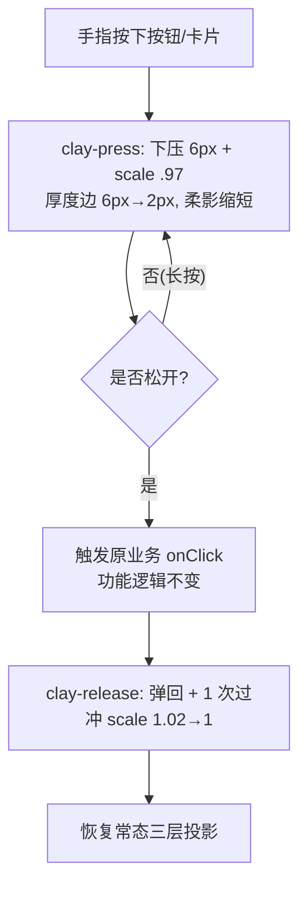
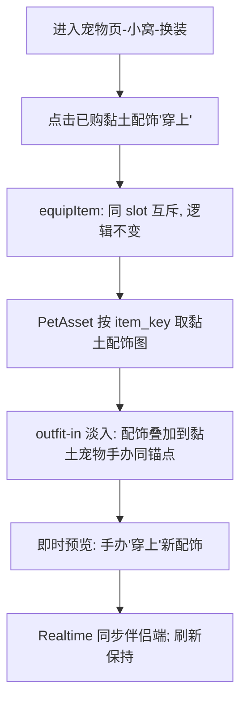

# 全界面 3D 黏土盲盒手办风重构 · 增量 PRD（3D v2）

> 文档版本：v3.0 ｜ 类型：增量 PRD ｜ 语言：简体中文
> 产品：许清楚（Xu）· Product Manager ｜ 基线：`docs/PRD.md` v1.0、`docs/PRD-pet-v2.md` v2.0、`docs/DESIGN.md` / `docs/DESIGN-pet-v2.md`
> 面向：架构师 / 工程师 / AI 出图执行人。**本文只定义视觉重构，8 大功能逻辑一律保持不变。**

---

## 1. 增量说明

### 1.1 本次改什么

| 项 | 现状（v1 / pet-v2） | 本次变更（3D v2） |
| --- | --- | --- |
| 整体画风 | 2D 水彩手绘（宠物模块）/ 平面粉紫渐变（其余界面） | **全 App 统一切到 3D 黏土盲盒手办风** |
| 覆盖范围 | 仅宠物模块用了 AI 插画，其余界面为平面 UI | **全界面**：5 Tab + 7 二级页 + 登录/配对 + 所有通用组件 |
| 主体视觉 | 44 项水彩素材（角色/背景/服饰/家具/明信片/道具） | **44 项全部重做为 3D 黏土图**（同名替换 + manifest 更新） |
| UI 控件 | MUI 圆角 + 单层柔影 | **CSS 黏土立体**：大圆角 + 多层投影 + 哑光渐变 + 内高光微浮雕 + 按压凹陷 |
| 图标 | lucide-react 线性图标，直接叠加 | **lucide 图标 + 黏土底座容器**（渐变圆角块 + 投影 + 内高光）呈现立体感；不额外 AI 生成图标 |
| 主题 token | 粉 `#F48FB1` / 紫 `#B39DDB` / 暖杏 `#FFE0B2` | **黏土马卡龙色板**（保留粉/紫/暖杏情侣色调），圆角/阴影/动效/字体统一升级 |

### 1.2 不改什么（红线）

> 以下各项**功能逻辑、数据结构、玩法完全不变**，本次一行代码逻辑都不动，仅替换视觉素材与样式 token：

| 范围 | 内容 | 状态 |
| --- | --- | --- |
| 8 大功能 | 配对 / 养宠物 / 定位 / 聊天 / 相册 / 纪念日 / 心愿打卡 / 悄悄话 | **保持不变** |
| 宠物系统 | 养成数值、旅行玩法、三叶草经济、商店、小窝布置、换装、5 套背景、明信片图鉴、共养同步 | **玩法不变**，只换素材与视觉表现 |
| 工程机制 | 演示模式、`Service` 双实现、`Result<T>`、HashRouter、Supabase RLS/Realtime/Storage、PWA / APK 打包 | **保持不变** |
| 数据实体 | `pets` 及宠物 5 张新表、其余 9 张业务表、RPC、RLS 策略 | **字段/结构不变**（见第 8 节） |

### 1.3 与上一版水彩风的关系

```
v1.0 简笔 SVG（全平面）→ v2.0 宠物模块水彩治愈（局部插画）→ v3.0 全 App 3D 黏土盲盒（全界面统一）
```

- **不是推翻 v2.0**：继承 v2.0 已建的「素材 key → `manifest.json` → `` 图层叠加 / 背景裁切」机制、`pet-assets` / `public/assets/pet/` 目录约定、`PetAsset` 单一图片出口；**只把图片内容换成 3D 黏土图**。
- **补齐割裂**：v2.0 存在「宠物 3D 水彩、界面平面」的视觉割裂，本次把**界面控件也黏土化**，做到宠物与 UI 同源同质感。
- **目标一致性**：所有素材像出自同一家黏土工作室的同一套盲盒系列——同一角色模板、同一视角、同一比例、同一光影、同一色系。

### 1.4 覆盖范围量化

- **5 个一级 Tab**：首页 Home / 聊天 Chat / 相册 Album / 宠物 Pet / 我的 Mine
- **7 个二级页**：登录 Login / 配对 Pairing / 纪念日 Anniversary / 心愿打卡 Wishlist / 悄悄话 Whispers / 定位 Location / 设置 Settings
- **全局组件**：Layout（顶栏 + 底部导航）、Common 全部通用组件、`theme.ts` / `tailwind.config.ts` / `index.css` / PWA manifest
- **44 项水彩素材**：全量替换为 3D 黏土图（详见第 5 节）

---

## 2. 重构目标与用户体验

### 2.1 产品目标

1. **质感升级**：从「扁平的水彩 App」升级为「捧在手心的黏土盲盒礼物盒」，每一屏都有可触摸的立体治愈感。
2. **全端统一**：消除「宠物页精致、其他页平面」的割裂，全 App 同一套材质语言。
3. **强化情侣温度**：用圆润、柔软、暖色调的黏土手办，承载「两个人 + 一只宠物」的陪伴叙事；保留粉/紫/暖杏情侣底色。
4. **工程可控**：主体视觉走 AI 生成图（一次性素材），UI 控件走 CSS（交互/响应式/不失真），图标走 lucide（成套/省积分），三者各司其职。

### 2.2 目标用户体验（用户故事）

| # | 用户故事 |
| --- | --- |
| 1 | 作为情侣一方，我希望打开 App 像拆一个盲盒，看到圆润哑光的黏土手办和柔软场景，感到治愈放松。 |
| 2 | 作为用户，我希望按钮、卡片按下去有"软软地凹陷再弹起"的黏土手感，让交互更有趣。 |
| 3 | 作为情侣一方，我希望给宠物换装时看到 3D 手办即时"穿上"新配饰，像真的在给盲盒手办换装。 |
| 4 | 作为用户，我希望所有页面的图标和卡片是同一套立体风格，不要有的立体有的扁平。 |
| 5 | 作为用户，我希望在保持可爱治愈的同时，粉紫暖杏的温馨情侣氛围不变。 |

### 2.3 体验关键词

`圆润` · `哑光` · `柔和光影` · `柔软可捏` · `盲盒手办` · `定格动画` · `治愈` · `情侣温馨`

---

## 3. 3D 黏土盲盒风视觉规范（重点）

> 本节是**设计与 AI 出图的唯一风格真理源**。所有素材、样式、动效必须遵守，确保跨批次、跨页面像同一套盲盒系列。

### 3.1 风格定义

**一句话定义**：**圆润矮胖的哑光黏土盲盒手办（matte clay, blind-box figurine），柔和影棚光（soft studio lighting），柔和弥散阴影，微细颗粒（subtle grain），可爱治愈，无高反光塑料感。**

| 维度 | 要求 | 反面（禁止） |
| --- | --- | --- |
| 形态 | `rounded chunky forms`：圆润、厚实、矮胖、无锐角、无硬边 | 尖锐棱角、细长写实比例 |
| 材质 | `matte clay`：哑光黏土/软陶，表面细腻微颗粒，微弱绒感 | 高光塑料、金属反光、玻璃质感、水彩晕染 |
| 光影 | `soft studio lighting`：左上主光 + 柔和环境补光，明暗过渡柔和不生硬 | 硬边黑影、强烈镜面高光、多光源冲突 |
| 投影 | 柔和弥散落地影（diffuse contact shadow），角色脚下有轻微接触阴影 | 生硬纯黑描边影、无影悬浮 |
| 情绪 | 可爱治愈、表情克制温柔、佛系呆萌 | 夸张、惊悚、写实 |
| 视角 | 角色统一 **3/4 正面视角**；场景统一 **轻微俯视 2.5D**；明信片正面平视 | 仰视、纯正侧面、透视混乱 |

### 3.2 色彩规范（黏土马卡龙色板）

> 保留原粉/紫/暖杏情侣温馨色调，整体提亮、降饱和，做成"马卡龙黏土"质感。色值供 CSS/主题用；AI 出图参考同一色系。

| 语义 | 色名 | 色值 | 用途 |
| --- | --- | --- | --- |
| 主色 | 黏土柔粉 Clay Pink | `#F4A6C1`（深 `#E983A8`） | 主按钮、主强调、选中态 |
| 辅色 | 黏土薰衣草 Clay Lavender | `#C4AEE8`（深 `#A98AD8`） | 次按钮、次强调、紫调区块 |
| 点缀 | 黏土暖杏 Clay Apricot | `#FFD9AE` | 暖色点缀、提醒、倒计时 |
| 清新 | 黏土薄荷 Clay Mint | `#BFE6D6` | 成就/成长/自然元素 |
| 底色 | 奶油白 Cream White | `#FFF8F1` | 卡片主体、黏土高光基底 |
| 页面底 | 柔粉雾 Blush Base | `#FBE9EF` | 页面背景（带暖杏/紫柔光晕） |
| 文字 | 黏土深墨 Clay Ink | `#5A4653` | 正文（比原 `#4A3B47` 更暖更柔） |
| 次文字 | 柔墨 Ink Soft | `#947F8F` | 辅助文字 |
| 内高光 | Highlight White | `rgba(255,255,255,.72)` | 黏土顶部高光 |
| 底座厚度 | Clay Base（粉） | `#EFB9CD` | 卡片/按钮下方"厚度实色边" |

**页面背景**：`#FBE9EF` 打底 + 暖杏/薰衣草两团大半径柔光晕（radial-gradient），模拟黏土影棚的柔和布光；保持 `background-attachment: fixed`。

### 3.3 材质与光影

- **哑光优先**：主体与 UI 均为哑光；仅允许极弱、面积很小的柔和高光点（如眼睛高光、黏土顶部微弧高光），禁止大面积镜面反射。
- **微颗粒**：AI 图含 `subtle grain` 细颗粒；CSS 控件可用极淡噪点叠加（`background-image` + 低透明度 SVG noise，可选）增强黏土真实感。
- **柔光方向统一**：所有素材左上主光；CSS 控件统一用"顶部/左上内高光 + 底部/右下投影"保持方向一致。
- **接触阴影**：角色/手办脚下有柔和椭圆接触影，避免悬浮感。

### 3.4 圆角规范（比水彩版整体加大，突出圆润）

| 级别 | 圆角 | 适用 |
| --- | --- | --- |
| 微圆 | `10px` | 小 chip 内元素、进度条端头 |
| 小圆 | `14px` | 图标底座、小按钮、输入框 |
| 中圆 | `20px` | 内容卡片、SectionCard、输入框、快捷入口 |
| 大圆 | `28px` | 大卡片、弹窗、GradientCard、底部导航顶部 |
| 胶囊 | `999px` | 主按钮、Chip、标签 |

> 原则：黏土手办"没有锐角"，全 App 禁用 `borderRadius: 0/2/4`。原 `theme.shape.borderRadius=16` 上调为 `20`，卡片覆盖为 `20~28`。

### 3.5 多层投影参数（黏土立体感核心）

> 用「**顶部内高光 + 实色厚度边 + 柔和落地影**」三层叠加做出"软陶块"的立体厚度。核心公式呼应：`0 8px 0 <厚度实色> + 0 16px 24px <柔影>`。

**标准黏土卡片（SectionCard / Paper）**
```css
box-shadow:
  inset 0 2px 0 rgba(255,255,255,.75),        /* 顶部内高光：微浮雕 */
  inset 0 -1px 0 rgba(120,80,100,.05),         /* 底部微暗，增加厚度 */
  0 8px 0 #F3CEDA,                             /* 黏土厚度实色边（8px） */
  0 16px 24px -8px rgba(120,80,100,.22);       /* 柔和落地影 */
```

**主按钮（contained / 胶囊）**
```css
background: linear-gradient(145deg, #F7B4CC 0%, #EC7FA6 60%, #C4AEE8 130%);
box-shadow:
  inset 0 2px 1px rgba(255,255,255,.55),       /* 顶部高光 */
  0 6px 0 #D9668F,                             /* 厚度边 */
  0 12px 18px -6px rgba(233,131,168,.5);       /* 柔影 */
```

**图标底座容器**
```css
width: 40px; height: 40px; border-radius: 14px;
background: linear-gradient(145deg, #FFE3EC 0%, #F7B4CC 100%);
box-shadow:
  inset 0 2px 1px rgba(255,255,255,.7),
  0 5px 0 #E7A7C0,
  0 8px 12px -4px rgba(120,80,100,.25);
/* lucide 图标居中叠加，strokeWidth=1.75，颜色 #E983A8 或 #fff（选中） */
```

> 厚度边颜色统一取对应主色的深色版；落地影统一 `rgba(120,80,100,α)` 暖紫灰，禁止纯黑。

### 3.6 内高光与微浮雕

- 每个立体控件叠加一层顶部高光（可用 `inset 0 2px 0 rgba(255,255,255,.7)` 或伪元素 `::before` 画一条顶部柔白弧）。
- 关键块（GradientCard / 大按钮 / 已选中 Tab）可加一条更明显的"黏土反光弧"：`::before` 定位在顶部 18% 高度、透明度 0.25 的白色椭圆弧。
- 文字与图标保持清晰对比，高光不得压低可读性。

### 3.7 动效规范（果冻弹跳 / 按压凹陷）

| 动效名 | 触发 | 关键帧描述 | 缓动 |
| --- | --- | --- | --- |
| `clay-press`（按压凹陷） | 按钮/卡片按下 | `translateY(0) → translateY(6px) + scale(.97)`，厚度边由 6~8px 收到 2px，落地影缩短；**按下有"捏下去"的凹陷感** | `150ms ease-out` |
| `clay-release`（松开回弹） | 松手 | 从凹陷态弹回，带 1 次轻微过冲 `scale(1.02) → 1` | `280ms cubic-bezier(.34,1.56,.64,1)` |
| `clay-jelly`（果冻弹跳） | 卡片入场 / 宠物互动 / 归来 | `scale 1 → 1.08/0.92 → 1.04/0.97 → 1`，纵向轻微拉伸 | `520ms cubic-bezier(.34,1.56,.64,1)` |
| `clay-hover`（悬浮微抬） | 桌面 hover | `translateY(-2px)`，投影加深 2px | `180ms ease` |
| `clover-grow` / `candy-fall` / `outfit-in` / `travel-glow` | 保留 v2.0 动效 | 原样保留，仅把配色换成黏土色板 | 原参数 |

- 全局尊重 `prefers-reduced-motion`：开启时改为 0 位移动画、仅保留透明度过渡。
- 移动端以 `clay-press` + `clay-jelly` 为主，避免复杂变形造成卡顿；用 `transform`/`opacity` 驱动。

### 3.8 字体规范

- **正文**：沿用系统圆润无衬线栈（`-apple-system / PingFang SC / Noto Sans SC`），保证离线与性能，不变。
- **标题/数字**：字重提升到 `700~800`，字距略紧（`-0.02em`），数字与"在一起天数"用更圆润的字形，强化手办标签感。
- **可选增强（P1）**：引入一款中文圆体 Web Font（如开源圆体）仅用于大标题/数字，需本地打包以兼容 PWA 离线；不强制，避免首屏体积膨胀。

### 3.9 图标 3D 化策略（固化）

> **决策：图标不 AI 生成，继续用 lucide-react（成套统一、strokeWidth=1.75、尺寸 18/20/24），通过"黏土质感底座容器 + 图标叠加"呈现立体感。**

- **普通态**：渐变圆角底座（14px 圆角）+ 内高光 + 5px 厚度边 + 柔影，lucide 线性图标居中叠加，图标色取主色深版。
- **选中态**：底座切为主色实心渐变、图标变白、厚度边加深、整体轻微下压（`translateY(2px)`），强化"按进去"的反馈。
- **收益**：省下几十张图标的 AI 积分；跨 12 个页面图标风格 100% 成套；矢量不失真、响应式无忧；与 lucide 现有依赖零冲突。
- **可选优化建议（非本期默认，见第 10 节待确认）**：若后续认为底座仍不够"黏土"，可为 5 个高频 Tab 图标做极少量定制 3D 黏土图标（约 5 张）作为锦上添花，但默认不做，优先保证成套统一与成本。

### 3.10 给 AI 出图的统一风格描述（指导语，非逐图 prompt）

> 出图执行人把下列描述作为**每张图的固定风格后缀/前缀**，保证成套；第 5 节只列"画什么 + 数量"，不写逐条 prompt。

**角色/手办类固定描述**：`a round chubby matte-clay blind-box figurine, soft rounded chunky forms, subtle clay grain texture, soft studio lighting from upper left, gentle diffuse contact shadow, cute healing expression, three-quarter front view, warm pastel macaron palette (cream #FFF8F1, clay pink #F4A6C1, lavender #C4AEE8, apricot #FFD9AE, mint #BFE6D6), no glossy plastic, no sharp edges, centered 60–70% with ≥10% margin, isolated on fully transparent background, no text, no watermark`

**场景类固定描述**：`a matte-clay diorama scene,软陶质感, soft studio lighting, gentle diffuse shadows, subtle grain, slight top-down 2.5D view, warm pastel macaron palette, no characters (unless specified), vertical composition, no text`

**成套铁律**：先出 **1 张角色基准图**并人工确认（五官/体色/比例），以其为参考图做 image-to-image 生成所有角色与配饰；背景/明信片/道具不含角色，仅复用风格描述，避免"第二只宠物"。

---

## 4. 全界面改造清单（逐页 / 逐组件）

### 4.1 全局基座

| 文件 | 改造内容 |
| --- | --- |
| `src/theme.ts` | 色板换黏土马卡龙色（3.2）；`shape.borderRadius` 16→20；`shadows` 改为三层黏土投影（3.5）；`MuiCard/Button/Chip/OutlinedInput/BottomNavigation/Switch/LinearProgress` 默认样式黏土化；contained 按钮改哑光渐变 + 6px 厚度边。 |
| `tailwind.config.ts` | `brand.*` 色值同步更新；新增 `clay` 工具类（阴影/圆角/高光）供布局复用。 |
| `src/index.css` | body 背景改柔粉雾 + 暖杏/紫柔光晕；新增 `clay-press/release/jelly/hover` 关键帧（3.7）；保留并换色 v2.0 动效；可选噪点层。 |
| `public/manifest.webmanifest` / `icon-*` | 主题色微调为黏土粉 `#F4A6C1`；PWA 图标黏土化（锦上添花项，见 5.2）。 |

### 4.2 五个一级 Tab

| Tab | 页面 | 3D 改造效果 |
| --- | --- | --- |
| 首页 | Home | 顶部"在一起天数"GradientCard 改**黏土礼物卡**（厚实圆角 + 顶部高光弧 + 8px 厚度边）；天数数字黏土浮雕；下一个纪念日卡、宠物概览卡改黏土卡；**4 个快捷入口改黏土方块按钮**（渐变底座 + 微投影，点击果冻按压）；宠物立绘换成 3D 黏土手办。 |
| 聊天 | Chat | 消息气泡改**黏土软糖气泡**（圆润厚边 + 柔影，自己/对方两种黏土色）；输入框改哑光凹陷槽（内阴影模拟"凹槽"）；发送按钮黏土胶囊 + 按压凹陷；表情面板图标加黏土底座；撤糖/爱心动效换黏土色。 |
| 相册 | Album | 照片墙卡片加**黏土相框边**（圆角厚边 + 柔影）；网格/时间轴卡片黏土化；上传入口改黏土"+"浮动按钮；大图预览弹窗改黏土托盘（圆角 28 + 厚度边）。 |
| 宠物 | Pet | 场景区用**3D 黏土场景背景 + 黏土宠物手办**（核心）；服饰为黏土配件图层，换装即时"穿上"预览（第 7 节）；数值条改黏土凹槽进度；庭院/旅行/小窝/图鉴 4 Tab 与商店弹窗全部黏土化；三叶草、明信片、家具、道具均为 3D 黏土素材。 |
| 我的 | Mine | 配对信息/邀请码卡改黏土卡；二维码放在黏土托盘中；定位开关改黏土 Switch（圆润厚实）；二级入口列表改黏土行卡；头像框黏土化。 |

### 4.3 七个二级页

| 页面 | 3D 改造效果 |
| --- | --- |
| 登录 Login | 背景改黏土影棚柔光；Logo/吉祥物换黏土手办（锦上添花）；输入框黏土凹槽；登录/注册按钮黏土胶囊；"演示模式入口"改黏土标签卡。 |
| 配对 Pairing | 创建/加入空间两张卡改**黏土双卡**；邀请码改黏土号码牌（浮雕数字）；二维码黏土托盘；配对成功可加黏土庆祝插画（锦上添花）。 |
| 纪念日 Anniversary | 倒计时数字改黏土浮雕大卡；纪念日列表项改黏土行卡；日期 chip 黏土化；到期撒糖动效换黏土色。 |
| 心愿打卡 Wishlist | 心愿项改黏土清单卡；打卡按钮改黏土圆钮（按下凹陷 + 完成果冻弹跳 + 黏土徽章）；连续天数/共同进度用黏土进度条与黏土徽章。 |
| 悄悄话 Whispers | 留言卡改黏土便签（圆角厚边 + 柔影）；心情标签黏土 chip；发布框黏土凹槽；撒糖粒子换黏土色爱心。 |
| 定位 Location | 双方位置卡改黏土卡片；可加黏土小地图场景（锦上添花）；共享开关黏土 Switch；"最后更新时间"黏土 chip。 |
| 设置 Settings | 设置项改黏土行卡；PWA 安装引导黏土卡；退出登录按钮黏土化（危险色用黏土暖红）。 |

### 4.4 UI 控件 3D 化规范

| 控件 | 规范 |
| --- | --- |
| 卡片 Card / SectionCard / GradientCard | 圆角 20~28；三层投影（3.5）；顶部内高光弧；Optional 噪点；渐变改哑光马卡龙。 |
| 按钮 Button | 胶囊 999；哑光渐变；6px 厚度边；`clay-press` 下压 + 松开回弹；禁用态降饱和、去厚度边。 |
| 输入框 Input / OutlinedInput | 14~20 圆角；凹槽用 `inset 0 2px 5px rgba(120,80,100,.12)` + 浅底；聚焦时边缘主色 + 轻微外发光（非生硬 2px 描边）。 |
| Chip / 标签 | 胶囊；小厚度边（3px）+ 内高光；选中实心主色。 |
| 底部导航 / 顶栏 | 底部导航黏土托盘（顶部大圆角 + 上柔影）；每项 = 图标黏土底座 + 文字；选中态底座实心 + 图标白 + 下压；顶栏改暖粉哑光渐变 + 柔影。 |
| 图标 Icon | 一律 lucide + 黏土底座（3.9），不 AI 生成。 |
| Switch / 进度条 / 弹窗 / 加载 / 空态 | Switch 圆润厚实带厚度边；进度条改凹槽（底部暗槽 + 黏土填充头）；Dialog 圆角 28 + 厚边 + 遮罩柔化；Loader 黏土心跳/旋转；EmptyState 图标放黏土底座并加黏土插画点缀。 |

### 4.5 通用组件（Common.tsx）逐项

`GradientCard`（黏土礼物卡）、`SectionCard`（黏土内容卡）、`EmptyState`（黏土底座 + 点缀插画）、`SmartImage`（加载失败改黏土占位块，不用破图）、`ImageViewer`（黏土托盘弹窗）、`CountdownChip`（黏土倒数牌）、`CandyRain`（黏土色粒子）、`PetIllustration`（宠物区已用 3D 黏土素材，SVG 版仅作兜底回退）、`SoftDivider`（黏土柔线）、`SoftButton`（黏土小胶囊）。`Layout`、`ProtectedRoute`、`DemoBanner` 同步黏土化（DemoBanner 用暖杏黏土提示条）。

---

## 5. AI 素材清单

> **只列视觉需求 + 数量 + 成套风格要求，不写 prompt。** 风格统一遵循第 3 节。现有 44 项水彩素材按同名/同 key 全量替换，工程侧 `manifest.json` 路径与 key 不变。

### 5.1 核心必做（P0，44 项 —— 全量替换现有水彩素材）

| 类别 | 素材项 | 数量 | 视觉需求与规格 | 分级 |
| --- | --- | --- | --- | --- |
| 宠物角色 · 成长阶段 | 蛋 / 幼年 / 少年 / 成年 | 4 | 3/4 正面黏土手办，统一五官体色，透明底 1024² | 核心 |
| 宠物角色 · 在家状态 | 看书 / 吃饭 / 睡觉 / 写信 / 发呆 / 开心 | 6 | 基准姿态 + 道具，同角色模板，透明底 1024² | 核心 |
| 宠物角色 · 旅行状态 | 背包出发 / 旅行归来 | 2 | 含黏土行囊/土特产，全身，透明底 1024² | 核心 |
| 场景背景 | 庭院小窝 / 星空 / 海边 / 卧室 / 花园 | 5 | 3D 黏土 diorama，轻俯视 2.5D，3:4 竖版 1080×1440 | 核心 |
| 服饰配件 | 草帽 / 针织帽 / 蝴蝶结 / 圆框眼镜 / 墨镜 / 花环 / 领结 / 围巾 | 8 | 黏土配件，透明底，与角色同锚点/比例可叠加 | 核心 |
| 家具摆件 | 小木床 / 毛线地毯 / 绿植 / 小书架 / 灯笼 / 茶几 / 秋千 / 玩具球 | 8 | 黏土摆件，透明底，512² | 核心 |
| 明信片 | 樱花 / 灯塔 / 温泉 / 神社 / 竹林 / 雪山 / 古城 / 星空草原 | 8 | 黏土微缩风景 + 统一手绘留白边框，4:3 横版 1280×960，分普通/稀有两档 | 核心 |
| 道具 | 三叶草丛 / 旅行道具精灵图（普通便当+豪华便当+护身符）/ 土特产包裹 | 3 | 黏土小道具，透明底，512²；1 张精灵图覆盖 3 类道具，视觉共覆盖 6 类 | 核心 |
| **合计** | | **44** | 与现有 44 项一一对应替换 | 核心 |

> 分项口径：角色 12 + 背景 5 + 服饰 8 + 家具 8 + 明信片 8 + 道具 3 = **44**，与 `public/assets/pet/` 现有文件数完全一致。道具 3 个文件中 `props_travel_sheet` 以精灵图形式覆盖普通便当/豪华便当/护身符 3 类，`clover_patch` 覆盖三叶草，`souvenir_parcel` 覆盖土特产；行囊视觉并入旅行角色素材，不单独占文件。

### 5.2 锦上添花（P1/P2 —— 全 App 额外黏土点缀，视预算分批）

| 素材项 | 数量 | 视觉需求 | 分级 |
| --- | --- | --- | --- |
| 首页欢迎卡黏土小场景（小心心/礼物盒） | 1 | 黏土小物，透明底 | P1 |
| 登录页黏土吉祥物 / 场景主视觉 | 1 | 与宠物同套黏土手办 | P1 |
| 配对成功黏土庆祝插画 | 1 | 双手办 + 爱心，透明底 | P2 |
| 空状态黏土插画（聊天/相册/留言） | 3 | 黏土小场景，透明底 | P2 |
| 聊天专属黏土表情贴纸（一套） | 8 | 圆润黏土 emoji 风格 | P2 |
| 成就/打卡黏土徽章 | 4 | 黏土奖章，透明底 | P2 |
| 定位页黏土小地图场景 | 1 | 黏土 diorama | P2 |
| PWA / APK 黏土图标 | 1 | 黏土手办头像，192/512 | P1 |
| **合计** | **20** | 不阻塞核心视觉，按预算追加 | 可选 |

### 5.3 成套统一要求（生成 checklist）

1. **基准先行**：先生成 1 张宠物角色基准图并人工确认五官/体色/比例，作为所有角色与配饰的唯一风格锚点。
2. **统一视角**：角色统一 3/4 正面；场景统一轻俯视 2.5D；明信片正面平视。
3. **统一比例**：角色 2~3 头身圆润矮胖；所有配饰与角色同锚点，可直接图层叠加无错位。
4. **统一光影**：全部左上柔光 + 柔和弥散接触影；无硬边黑影、无镜面高光。
5. **统一色系**：黏土马卡龙色板（3.2），跨批次像同一盲盒系列。
6. **统一材质**：哑光黏土 + 微颗粒，无塑料反光、无水彩晕染。
7. **透明底无白边**：角色/服饰/家具/道具 PNG-24 透明底；统一裁边、主体占 60~70%、四周≥10% 留白；在奶油白底上检查透明边缘。
8. **明信片成套**：8 张统一边框风格，普通/稀有以边框色区分（稀有加暖金微光描边）。
9. **manifest 登记**：每张图生成后按原 key 写入 `manifest.json`，工程只认 key，替换零改代码。
10. **优化复用**：道具精灵图合并、家具 `scaleX(-1)` 镜像、背景 CSS 滤镜派生时段变体，减少生成张数。

---

## 6. 需求池（P0 / P1 / P2）

> **P0 = 本期必交付；P1 = 本期应有增强；P2 = 后续可选优化。** 全部需求仅涉及视觉，验收标准均含"功能不变"校验。

| 编号 | 需求描述 | 优先级 | 验收标准 |
| --- | --- | --- | --- |
| 3D-01 | **视觉规范落地**：黏土色板/圆角/三层投影/内高光/动效写入 `theme.ts`+`tailwind`+`index.css` | P0 | 全站 token 与新规范一致；无锐角控件；375px 无溢出；功能交互不变 |
| 3D-02 | **44 项素材 3D 黏土化替换**：按第 5.1 节全量重做并按 key 覆盖 | P0 | 44 项均为黏土风、风格统一、透明底无白边；key 不变、页面正确取图；玩法不变 |
| 3D-03 | **角色基准与成套一致性**：先出基准图，image-to-image 生成角色与配饰 | P0 | 跨所有立绘五官/体色/比例一致；配饰叠加无错位；无"第二只宠物" |
| 3D-04 | **全局组件黏土化**：Layout / Common 全部组件（卡片/按钮/输入/Chip/导航/弹窗/空态） | P0 | 组件呈三层黏土立体；按压有凹陷回弹；交互/可访问性不变 |
| 3D-05 | **图标 3D 化策略**：lucide + 黏土底座容器，普通/选中态规范 | P0 | 全站图标成套立体；不新增 AI 图标；选中态反馈清晰；尺寸 stroke 不变 |
| 3D-06 | **5 个 Tab 页全量改造**：Home/Chat/Album/Pet/Mine | P0 | 5 页视觉全部黏土化；各页功能与数据展示完全不变 |
| 3D-07 | **7 个二级页全量改造**：Login/Pairing/Anniversary/Wishlist/Whispers/Location/Settings | P0 | 7 页视觉全部黏土化；流程与功能完全不变 |
| 3D-08 | **宠物换装/场景 3D 预览**：黏土配饰图层即时叠加、背景切换 | P0 | 换装即时正确叠加；5 套黏土背景切换；养成/旅行玩法不变 |
| 3D-09 | **动效黏土化**：`clay-press/release/jelly/hover` + 保留 v2.0 动效换色 | P0 | 按压凹陷/果冻弹跳生效；尊重 reduced-motion；沿用 transform/opacity |
| 3D-10 | **数据模型零功能变更确认**：仅素材路径/manifest/前端主题配置变更 | P0 | 无 DB 迁移、无字段变更；8 大功能数据读写不变；演示/真实双模式均正常 |
| 3D-11 | **PWA / APK 视觉同步**：主题色/图标/PWA 安装卡黏土化（图标为锦上添花） | P1 | manifest 主题色更新；打包成功；离线演示模式视觉正常 |
| 3D-12 | **登录/配对/首页黏土点缀插画**：吉祥物/欢迎卡/庆祝插画 | P1 | 插画为黏土风且成套；不影响登录配对流程 |
| 3D-13 | **聊天黏土表情贴纸 + 心情徽章** | P2 | 一套黏土表情可用于聊天；打卡徽章黏土化；消息类型逻辑不变 |
| 3D-14 | **定位页黏土小地图 + 空状态插画** | P2 | 视觉增强；定位授权/展示逻辑不变 |
| 3D-15 | **可选：5 个 Tab 图标定制 3D 黏土图标** | P2 | 仅当底座方案验收不足时启用；保持成套；成本另计 |

---

## 7. 关键流程

### 7.1 3D 卡片按压缩放流程



### 7.2 宠物换装 3D 预览流程（玩法不变，只换视觉）



### 7.3 全局主题切换（本次为一次性切到黏土，非运行时切换）

> 本期为**开发期一次性替换**主题 token 与素材，不提供用户运行时切换入口（避免功能变更）。若未来需要"水彩/黏土"双主题切换，属功能新增，不在本期范围（见第 10 节）。

---

## 8. 数据模型变更点（确认）

> **结论：本期不新增业务字段、不新增表、不写数据库迁移；功能数据零变更。** 变更仅发生在"素材路径"与"前端主题配置"两层。

| 层面 | 变更内容 | 是否影响功能数据 |
| --- | --- | --- |
| Supabase 表结构 | **无变更**。9 张业务表 + 宠物 5 张新表字段、RPC、RLS、Realtime 全部不动 | 否 |
| `pet_items.asset_path` | 仅**路径字符串**可能随目录调整；建议**同名同路径覆盖图片文件**，则字段值都不用改 | 否（仅路径文本） |
| `manifest.json` | 各 key 对应图片内容换为黏土图；key / 尺寸 / 锚点保持一致 | 否 |
| `src/theme.ts` / `tailwind.config.ts` | 纯前端设计 token（色值/圆角/阴影/动效）更新 | 否 |
| `src/index.css` | 纯样式与关键帧更新 | 否 |
| 新增主题配置 | 建议新增纯前端常量文件（如 `src/theme-clay.ts`）集中管理黏土 token，**不入库** | 否 |
| PWA manifest | `theme_color` / 图标文件替换 | 否 |

- **确认**：不新增 `theme_style` 之类的数据库字段，也不提供运行时主题切换开关——那属于功能变更，违反"只改视觉"红线。
- **迁移策略**：素材替换采用"同名覆盖 + manifest 内容更新"，零 SQL 执行；工程按 key 取图逻辑完全不变（`PetAsset` / `PetImage` 无需改动）。

---

## 9. 成本与范围提示

- **AI 素材积分预估**：按约 5–10 积分/张。核心 44 项约 **220–440 积分**（含基准图与少量重生成建议预留至 **300–500 积分**）；锦上添花 20 项另需约 **100–200 积分**，按预算分批。
- **省积分措施**：道具精灵图合并、家具镜像复用、背景 CSS 滤镜派生时段变体、明信片换框复用、基准图 image-to-image 传风格——可少生成 10~20 张。
- **图标用 CSS 不改 AI 的取舍**：全 App 图标数量多（12 页 + 组件，累计可达数十个）。若逐个 AI 生成将额外消耗数百分积分且难保证成套；采用「lucide + 黏土底座容器」**省积分、矢量不失真、响应式友好、风格 100% 成套**，仅牺牲"图标本身是 3D 手办"的极致效果。这是成本与一致性的最优取舍。
- **范围边界**：本期是纯前端视觉工程，工作量集中在 AI 出图 + 样式 token + 组件样式覆盖；无后端改动、无 DB 迁移、无功能回归风险。主要风险是**跨批次素材风格一致性**，靠基准图 + 成套 checklist 控制。

---

## 10. 待确认问题

1. **角色物种视觉**：宠物数据仍是青蛙（`frog`，玩法不变）；本轮黏土手办是否保持青蛙造型，还是仅换材质不改物种？（本文默认**保持青蛙，只换黏土材质**）
2. **基准图归属**：由谁生成/审核宠物黏土基准图？需先确认基准图再批量出图，避免错误基准上浪费积分。
3. **主题切换**：是否未来需要"水彩/黏土"运行时切换？本期默认**不做**（属功能新增）；若需要，需另立功能 PRD。
4. **中文圆体 Web Font**（3.8 P1）是否引入？需权衡首屏体积与 PWA 离线本地打包。
5. **图标极致效果**：底座方案验收后，是否追加 5 个 Tab 的定制 3D 黏土图标（3D-15）？默认不做。
6. **锦上添花范围**：5.2 的 20 项按预算分批，是否本期全做、还是仅做 P1（登录吉祥物/首页欢迎/PWA 图标）？
7. **AI 出图托管**：素材仍放本地 `public/assets/pet/`（沿用 v2.0），还是同步更新 `pet-assets` Storage 桶？默认本地为主、桶可选。
8. **动效强度**：黏土按压/弹跳幅度是否接受？是否需要在设置中提供"减少动效"开关（若做则属功能新增，默认靠系统 `prefers-reduced-motion`）。
9. **文案与品牌名**：本次只改视觉，页面文案/品牌名" Couple Space"保持不变，是否确认？
