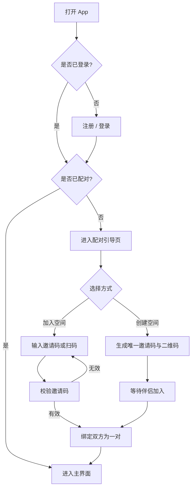
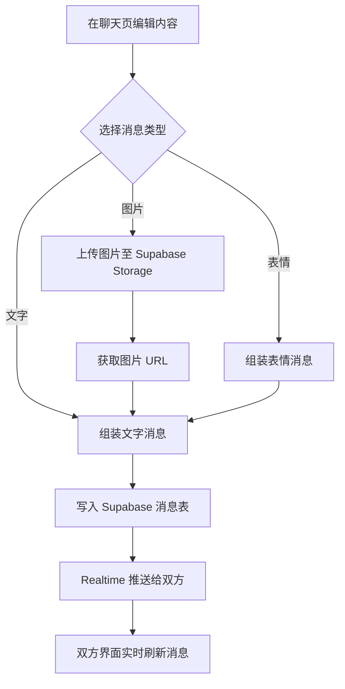

# 情侣私人 App（Couple Space）产品需求文档

> 文档版本：v1.0 ｜ 类型：简单 PRD ｜ 语言：简体中文

## 项目信息

| 项目 | 内容 |
| --- | --- |
| 项目名称 | `couple_space` |
| 文档语言 | 简体中文 |
| 前端技术栈 | Vite + React + MUI + Tailwind CSS |
| 后端服务 | Supabase（Auth / Postgres / Realtime / Storage） |
| 交付形态 | Web（GitHub Pages）+ PWA（可安装桌面）+ Android APK（Capacitor） |
| 设计基线 | 温柔情侣风（粉/紫/暖色）、图标成套统一（lucide-react）、移动端优先 |

**原始需求复述**：打造一个界面美观、图标统一的情侣私人 App。情侣通过邀请码/二维码绑定为专属私人空间，在此空间内共同养宠物、共享定位、实时聊天、共享相册、记录纪念日、完成心愿打卡、互留悄悄话。支持零配置演示模式、GitHub Pages 部署、PWA 安装与 Capacitor 打包 APK。**明确不做锁机功能。**

---

## 1. 产品目标

1. **建立专属私人空间**：通过邀请码/二维码完成两人的唯一绑定，构建只有彼此可访问的私密数字空间。
2. **承载日常亲密互动**：以聊天、宠物、相册、留言板为核心，让情侣随时表达爱意、同步生活动态。
3. **见证关系共同成长**：通过在一起天数、纪念日倒计时、宠物养成和心愿打卡，沉淀共同回忆与目标。
4. **美观且易用**：移动端优先、视觉风格温柔统一、图标成套一致，保证低门槛上手。
5. **轻量可交付**：无需后端密钥即可预览的演示模式，支持一键部署 GitHub Pages 与打包 Android APK。

---

## 2. 目标用户与用户故事

**目标用户**：处于恋爱关系中的情侣（含异地与同城），希望拥有一个私密、美观、可长期记录共同生活的应用。

| # | 对应功能 | 用户故事 |
| --- | --- | --- |
| 1 | 登录认证 | 作为用户，我希望用账号安全登录并保存我们的数据，以便只有我们两人能访问这个私人空间。 |
| 2 | 情侣配对绑定 | 作为首次使用的用户，我希望通过邀请码或二维码与伴侣绑定，以便快速进入属于我们的专属空间。 |
| 3 | 养宠物 | 作为情侣中的一方，我希望和伴侣一起喂食、照顾虚拟宠物，以便看着它成长并享受共同付出的乐趣。 |
| 4 | 定位共享 | 作为异地情侣，我希望查看对方的大致位置与最后更新时间，以便了解对方动态、增进安全感。 |
| 5 | 实时聊天 | 作为情侣中的一方，我希望发送文字、图片和表情并实时收到对方回复，以便随时随地亲密沟通。 |
| 6 | 情侣相册 | 作为情侣，我希望上传并浏览共同的照片墙，以便按时间回顾我们的美好瞬间。 |
| 7 | 恋爱纪念日 | 作为情侣，我希望看到在一起天数和纪念日的倒计时，以便不错过每一个重要日子。 |
| 8 | 共同心愿打卡 | 作为情侣，我希望共同制定心愿清单并进行每日打卡，以便一起完成目标、互相激励。 |
| 9 | 悄悄话留言板 | 作为情侣，我希望留下私密留言和心情日记，以便用撒糖的方式记录日常心情。 |
| 10 | 演示模式 | 作为尚未配置 Supabase 的预览用户，我希望不填密钥就能直接体验完整界面，以便快速了解产品效果。 |

---

## 3. 需求池

> 优先级：**P0 = 必须有**（MVP 核心）｜**P1 = 应该有**（提升体验）｜**P2 = 可以有**（增强/辅助）

| 编号 | 需求描述 | 优先级 | 验收标准 |
| --- | --- | --- | --- |
| FR-01 | **用户登录认证**：基于 Supabase Auth 实现注册/登录（邮箱+密码），会话持久化。 | P0 | 未登录跳转登录页；注册/登录成功进入主界面；刷新后保持登录；退出登录清除会话。 |
| FR-02 | **情侣配对绑定**：一方创建空间生成邀请码/二维码，另一方通过输入邀请码或扫码加入，绑定双方为一对。 | P0 | 成功生成唯一邀请码与可扫码二维码；输入正确邀请码后双方绑定成功；一个空间最多绑定 2 人；已绑定用户不可重复创建空间。 |
| FR-03 | **实时聊天**：支持文字、图片、表情消息的发送与接收，基于 Supabase Realtime 双向同步。 | P0 | 发送消息后双方界面实时更新；图片可预览；提供表情面板；消息按时间排序；断线重连后消息不丢失。 |
| FR-04 | **演示/本地模式**：未配置 Supabase 密钥时自动进入演示模式，使用内置假数据展示全部界面与交互（数据不持久化）。 | P0 | 无环境变量时可正常启动并浏览所有页面；演示数据完整（聊天/相册/宠物等）；界面有明显"演示模式"提示；登录/配对流程可用模拟流程走通。 |
| FR-05 | **养宠物**：共同养一只虚拟宠物，支持喂食、互动，具有成长值与心情值，状态双方同步。 | P1 | 双方均可触发喂食/互动；成长值、心情值随互动变化并实时同步；宠物随成长阶段呈现不同状态；数据持久化。 |
| FR-06 | **情侣相册**：共享照片墙，上传图片至 Supabase Storage，按时间轴浏览。 | P1 | 可上传图片并生成缩略图；照片墙按时间倒序展示；双方均可上传与浏览；大图可放大查看。 |
| FR-07 | **恋爱纪念日**：在一起天数计数，生日/纪念日倒计时与到期提醒。 | P1 | 首页展示在一起天数；可增删纪念日；显示距下一个纪念日的倒计时；到期时在 App 内给出提醒。 |
| FR-08 | **定位共享**：双方共享大致位置与最后更新时间，Web 端使用浏览器定位 API 并需隐私授权。 | P2 | 经用户授权后获取位置并在地图/卡片展示；显示"最后更新时间"；可随时关闭共享；未授权时给出友好提示；默认仅展示大致位置以保护隐私。 |
| FR-09 | **共同心愿打卡**：心愿清单 + 每日/习惯打卡，双方共同完成目标。 | P2 | 可新增/编辑/完成心愿；支持每日打卡并记录连续天数；双方打卡状态同步；展示共同完成进度。 |
| FR-10 | **悄悄话留言板**：私密留言、心情日记、日常撒糖互动。 | P2 | 可发布留言/日记；仅空间内双方可见；按时间展示；支持简单的心情标签或撒糖动效。 |
| NFR-01 | **PWA 与 APK 交付**：支持 PWA 安装到手机桌面，并通过 Capacitor 打包 Android APK。 | P1 | 配置 manifest 与 Service Worker，浏览器可"添加到主屏幕"；Capacitor 可成功构建 APK；离线时演示模式仍可展示。 |
| NFR-02 | **视觉与图标统一**：温柔情侣风配色，lucide-react 成套线性图标，移动端优先响应式布局。 | P1 | 全站配色与圆角/阴影规范一致；图标风格与描边统一；在 375px 宽度下布局无溢出、可正常操作。 |
| NFR-03 | **部署友好**：项目可静态部署至 GitHub Pages。 | P1 | 构建产物为纯静态资源；路由与资源路径在 Pages 子路径下可正常访问；提供部署说明。 |

> 说明：用户已明确**不做锁机功能**，本需求池不包含该项。

---

## 4. 信息架构与页面设计

### 4.1 导航结构

- 未登录 → 登录页；已登录未配对 → 配对引导页；已配对 → 主框架（底部 5 个 Tab）+ 二级功能页。

### 4.2 页面清单

**一级导航（底部 Tab，移动端）**

| Tab | 页面 | 主要内容 |
| --- | --- | --- |
| 首页 | Home | 在一起天数计数、宠物状态概览、最近纪念日倒计时、心愿/留言快捷入口 |
| 聊天 | Chat | 消息列表会话、文字/图片/表情输入、实时消息流 |
| 相册 | Album | 共享照片墙（瀑布/网格）、时间轴浏览、上传入口、大图预览 |
| 宠物 | Pet | 宠物主形象、喂食/互动按钮、成长值与心情值、成长阶段展示 |
| 我的 | Mine | 配对信息与邀请码/二维码、定位共享开关、二级功能入口、设置 |

**二级功能页（从首页或"我的"进入）**

| 页面 | 入口 | 主要内容 |
| --- | --- | --- |
| 登录页 Login | 首次启动 | 注册/登录、演示模式入口 |
| 配对引导页 Pairing | 已登录未配对 | 创建空间（生成邀请码/二维码）/ 加入空间（输入邀请码/扫码） |
| 纪念日页 Anniversary | 首页 / 我的 | 在一起天数设置、纪念日增删改、倒计时列表、提醒设置 |
| 心愿打卡页 Wishlist | 首页 / 我的 | 心愿清单、每日打卡、连续天数、共同进度 |
| 悄悄话留言板 Whispers | 首页 / 我的 | 留言/日记列表、发布框、心情标签、撒糖动效 |
| 定位共享页 Location | 我的 | 双方位置卡片/地图、最后更新时间、共享开关与授权说明 |
| 设置页 Settings | 我的 | 账号信息、PWA 安装引导、通知设置、退出登录 |

### 4.3 视觉风格与配色

- **风格定位**：温柔情侣风，圆角卡片、柔和阴影、充足留白、轻盈微动效（撒糖/宠物互动）。
- **主色**：柔粉 `#F48FB1`、薰衣草紫 `#B39DDB`
- **点缀/暖色**：暖杏 `#FFE0B2`、浅粉背景 `#FCE4EC`
- **文字色**：深暖灰紫 `#4A3B47`
- **图标**：统一使用 `lucide-react` 线性图标，描边一致（约 1.75px），尺寸成套。
- **字体与布局**：圆润无衬线字体；移动端优先，响应式适配平板/桌面。

---

## 5. 关键用户流程

### 流程一：首次进入与配对

### 流程二：聊天消息发送

---

## 6. 待确认问题

1. **定位精度与隐私**：定位共享是否仅展示"大致位置/城市级"？是否需要在关闭 App 后持续上报，还是仅手动刷新时更新？
2. **账号方式**：登录是否仅提供邮箱+密码，是否需要手机号或第三方登录？
3. **宠物设定**：宠物形象采用预设（如猫咪）还是允许用户选择/自定义？成长阶段如何划分、是否有上限？
4. **提醒机制**：纪念日与打卡提醒是仅 App 内提示，还是需要浏览器通知 / 系统推送（PWA）？
5. **数据导出与留存**：聊天记录、照片与日记是否需要支持备份导出？是否设定数据保留期限？
6. **演示模式切换**：用户配置 Supabase 后，演示数据是否需要提供迁移或清空选项？
